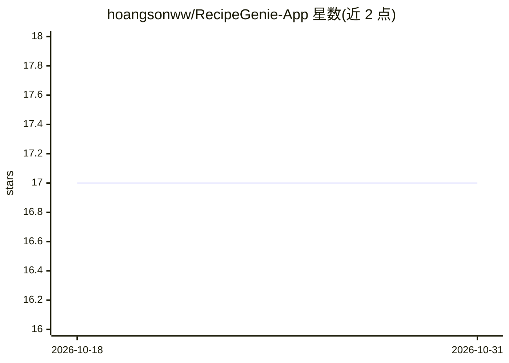

# hoangsonww/RecipeGenie-App

⭐ 17 · Swift · MIT · 推送 2026-09-27 · [GitHub](https://github.com/hoangsonww/RecipeGenie-App) · [官网](https://recipe-genie.netlify.app/) · 个人维护

**食谱查询与烹饪辅助 Web/移动应用，含问答聊天机器人**

面向烹饪用户的食谱应用：提供食谱数据库检索（按食材、菜名、饮食偏好）、收藏管理、烹饪计时器、社交分享与响应式界面；其中 AI 部分为交互式聊天机器人，提供协助与建议。Web 版基于 HTML/CSS/JavaScript 与 Node.js，通过 git clone 与 npm install 后在浏览器打开或本地服务器运行；移动版使用 Swift、Kotlin/Java 与 Apache Cordova 构建，可经 Xcode 或 Cordova 命令构建模拟运行。技术栈中还列出 Python 后端、MongoDB、Firebase 等。

## 筛选速览

| 维度 | 判定 | 备注 |
|---|---|---|
| AI 角色 | `ai-enhanced` | 去掉 AI 部分产品仍成立 |
| 许可风险 | `permissive` | MIT |
| 部署形态 | `library` | 以包/库形式分发 |
| 模型依赖 | — | README 未给出锁定关系 |
| 硬件要求 | — | 无带数字的原话,不猜 |
| 安装摩擦 | `low` | 无编译、无系统依赖或容器化 |
| 成熟度 | — | 结构信号不足 |

## 能力要点

- 按食材、菜名、饮食偏好检索食谱数据库
- 收藏管理、烹饪计时器与社交分享功能
- 交互式聊天机器人提供协助与建议
- 提供 iOS（Xcode）与 Android（Cordova）移动版构建路径

## 适用场景

- 按手头食材或饮食偏好查找菜谱
- 烹饪时用内置计时器跟踪多道菜进度
- 通过聊天机器人获取烹饪建议

## 场景标签

`聊天机器人` · 领域:对话与助手

## 证据(README 行号)

> L23: - **Interactive Chatbot**: Get assistance and suggestions from our RecipeGenie chatbot.
> L5: RecipeGenie is a feature-rich, user-friendly web application designed to simplify and enhance the cooking experience

## 星数曲线

2026-10-18 17 → 2026-10-31 17（+0）

---
*卡片 v1 · prompt 1.4 · 生成 2026-10-29 · 置信度 mid · 依据 README sha `801b45c4642c` · [字段定义](../../DATASET.md)*
