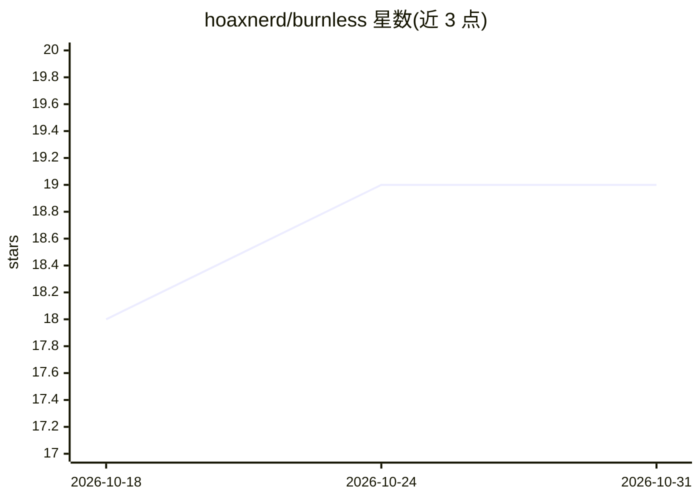

# hoaxnerd/burnless

⭐ 19 · TypeScript · AGPL-3.0 · 推送 2026-07-23 · [GitHub](https://github.com/hoaxnerd/burnless) · [官网](https://burnless.ai) · 个人维护

**面向创始人的自托管 AI 财务伴侣：实时监控 burn/runway**

自托管的创业公司财务工具：读取真实财务数据，持续监控 burn、runway、收入与支出，并通过 AI 伴侣用自然语言构建 what-if 场景（场景模式为对真实数据的非破坏性覆盖层）。计算由确定性 Decimal 精度财务引擎完成，AI 通过工具操作该引擎而非自行计算。提供商无关的 AI 层支持 Anthropic/OpenAI/OpenRouter/本地 Ollama；单命令安装，内嵌 PGlite 数据库，无需 Docker 或 Postgres。还提供预测、融资轮次/股权表、报表导出、MCP 服务端暴露等能力。

## 筛选速览

| 维度 | 判定 | 备注 |
|---|---|---|
| AI 角色 | `ai-native` | 本体是模型或模型工具 |
| 许可风险 | `viral` | AGPL-3.0 |
| 部署形态 | `library` | 以包/库形式分发 |
| 模型依赖 | local-ok | 支持本地模型 |
| 硬件要求 | — | 无带数字的原话,不猜 |
| 安装摩擦 | `low` | 无编译、无系统依赖或容器化 |
| 成熟度 | — | 结构信号不足 |

## 能力要点

- AI 伴侣通过工具操作确定性财务引擎（计算可溯源，非模型生成）
- 场景模式：what-if 作为非破坏性覆盖层，可与基准对比
- 提供商无关 AI 层：Anthropic/OpenAI/OpenRouter/本地 Ollama
- 单命令自托管，内嵌 PGlite，数据留在本机，支持 MCP 客户端与服务端

## 适用场景

- 我想实时掌握公司 burn 和 runway 而不是月底才发现
- 用自然语言试算招聘/融资/削减成本对现金的影响
- 自托管财务模型，敏感数据与 AI 密钥不离开自己的基础设施

## 场景标签

`数据分析` · 领域:效率与自动化

## 证据(README 行号)

> L13: **Burnless is the always-on financial companion for founders.** It reads your real financials and watches your burn
> L41: - **AI companion** — a chat that reads your live financials and takes actions through tools (build a scenario, adju
> L47: - **Bring any AI** — a provider-agnostic layer works with Anthropic, OpenAI, OpenRouter, or fully local with Ollama

## 星数曲线

2026-10-18 18 → 2026-10-31 19（+1）

---
*卡片 v1 · prompt 1.4 · 生成 2026-10-28 · 置信度 high · 依据 README sha `bde67d2fac40` · [字段定义](../../DATASET.md)*
