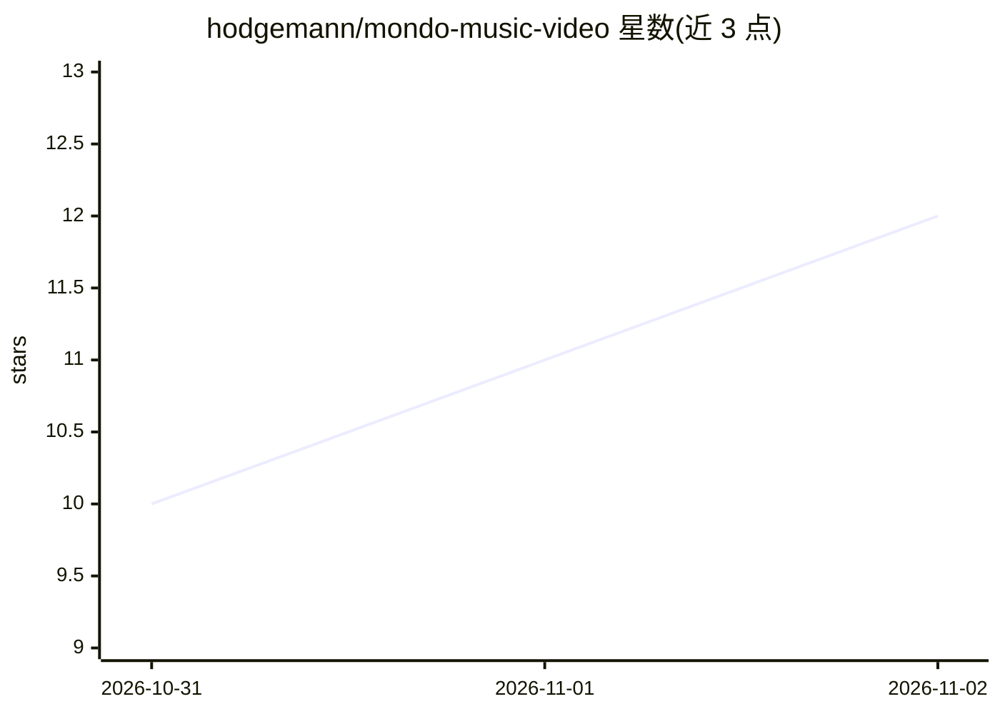

# hodgemann/mondo-music-video

⭐ 12 · Python · Apache-2.0 · 推送 2026-11-01 · [GitHub](https://github.com/hodgemann/mondo-music-video) · 个人维护

**把歌曲转成完整音乐视频的应用：节拍感知规划+LLM 写提示词+渲染合成**

面向创作者的音乐视频生成应用：分析上传歌曲的节拍、能量与段落，由 seeded planner 生成四种蒙太奇语法分镜；LLM 负责撰写视觉提示词并由 GPU Laya 审查，随后通过 ComfyUI（本地工作流或官方 Comfy SDK 代理）或付费 API 渲染，最终按帧对齐剪辑并还原原曲音频。支持演员舞蹈、口型同步、乐器演奏、OAP/OPP 演员/道具包、Worlds 设定库与歌词字幕。用户需自备模型、媒体与 API key，模型权重与第三方商业软件不随附。可通过具备终端权限的编码 agent 安装，提供 MCP 工具。

## 筛选速览

| 维度 | 判定 | 备注 |
|---|---|---|
| AI 角色 | `ai-native` | 本体是模型或模型工具 |
| 许可风险 | `permissive` | Apache-2.0 |
| 部署形态 | `library` | 以包/库形式分发 |
| 模型依赖 | — | README 未给出锁定关系 |
| 硬件要求 | — | 无带数字的原话,不猜 |
| 安装摩擦 | `medium` | 含编译或系统依赖之一 |
| 成熟度 | — | 结构信号不足 |

## 能力要点

- 节拍/能量/段落检测驱动四种蒙太奇语法分镜规划
- LLM 撰写提示词 + 渲染前后双重质量检查与重试机制
- Open Actor/Prop Protocol 演员道具包与 Worlds 世界观设定
- 本地 ComfyUI/Comfy SDK 或付费 API 渲染，帧精确合成还原原曲

## 适用场景

- 把一首歌自动生成带节拍驱动剪辑的完整音乐视频
- 用一致的参考图演员和道具制作系列视频
- 维护共享世界观（Worlds）保持多支视频设定统一

## 场景标签

`视频生成` · 领域:内容生成

## 证据(README 行号)

> L50: Turn your song into a complete music video. Mondo listens to the track, detects
> L53: shots. An LLM writer develops the visuals from your direction, style and cast;

## 星数曲线

2026-10-31 10 → 2026-11-02 12（+2）

---
*卡片 v1 · prompt 1.4 · 生成 2026-11-02 · 置信度 high · 依据 README sha `2c8b8ba9230c` · [字段定义](../../DATASET.md)*
