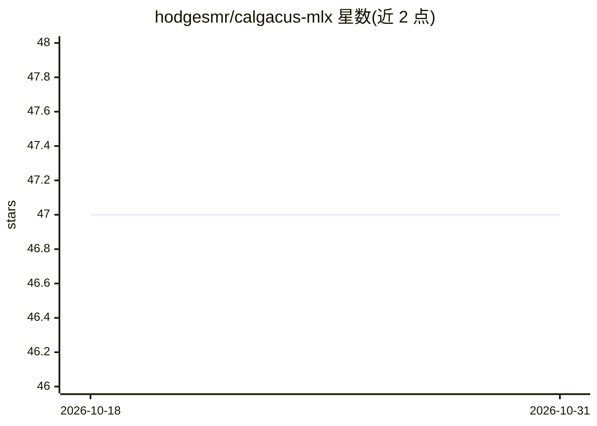

# hodgesmr/calgacus-mlx

⭐ 47 · Python · BSD-3-Clause · 推送 2026-07-01 · [GitHub](https://github.com/hodgesmr/calgacus-mlx) · 个人维护

**在普通文本中无损隐藏秘密消息的 LLM 隐写术 CLI**

Calgacus 协议（Norelli & Bronstein, 2025）的 MLX Python 实现：给定秘密消息，通过语言模型每个位置 next-token 分布的秩驱动选取，生成一段读起来像普通散文、长度相近的 stegotext；持有相同模型、cover prompt 与 keyfile 的接收方逐字节无损还原。提供 init/encode/decode 三个子命令，keyfile 为 TOML 格式共享密钥。仅在 Apple Silicon 本地运行（依赖 MLX），需 Python 3.11+ 与 uv，首次运行下载约 3.3GB 默认模型。

## 筛选速览

| 维度 | 判定 | 备注 |
|---|---|---|
| AI 角色 | `ai-native` | 本体是模型或模型工具 |
| 许可风险 | `permissive` | BSD-3-Clause |
| 部署形态 | `None` |  |
| 模型依赖 | — | README 未给出锁定关系 |
| 硬件要求 | — | 无带数字的原话,不猜 |
| 安装摩擦 | `medium` | 含编译或系统依赖之一 |
| 成熟度 | — | 结构信号不足 |

## 能力要点

- 基于 next-token 分布秩驱动的无损文本隐写编码/解码
- keyfile.toml 捆绑模型、cover prompt、secret prefix 与 trailer 供双方共享
- 支持 stdin/文件输入，可隐藏并一键还原执行 shell 命令
- 附带 trailer 与 natural tail 机制改善 stegotext 可读性

## 适用场景

- 在看似普通的文本通道中传递秘密消息
- 隐藏命令或结构化数据并在线还原
- 研究 LLM 隐写协议的实现细节

## 场景标签

 · 领域:LLM 隐写术/安全

## 证据(README 行号)

> L3: LLM Steganography: Hide a meaningful text inside another plausible text of comparable length.
> L5: MLX implementation of the Calgacus protocol (Norelli & Bronstein, 2025) for LLM-based text steganography. Given a se
> L7: This is a Python CLI that runs locally on Apple Silicon via MLX.

## 星数曲线

2026-10-18 47 → 2026-10-31 47（+0）

---
*卡片 v1 · prompt 1.4 · 生成 2026-10-25 · 置信度 high · 依据 README sha `ac722d65c132` · [字段定义](../../DATASET.md)*
