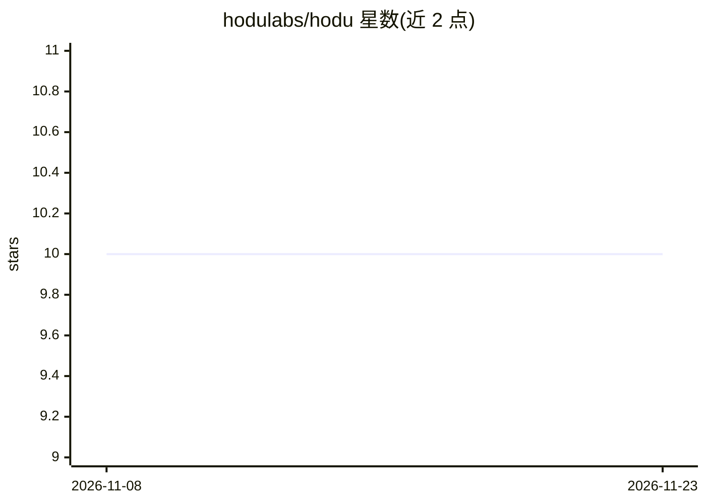

# hodulabs/hodu

⭐ 10 · Rust · Apache-2.0 · 推送 2026-07-14 · [GitHub](https://github.com/hodulabs/hodu) · [官网](https://git.daminstudio.net/dms.hodulabs/hodu) · 个人维护

**Rust 机器学习框架，提供 NumPy 风格张量与训练部署工具链**

构建在 kurumi 引擎之上的 Rust 机器学习框架：在引擎的严格原语（同形状同 dtype）之上插入广播与 dtype 提升，提供带运算符重载的 Tensor、nn 模块（Conv2d、多头注意力、transformer、LSTM/GRU、各类 Norm）、SGD/Adam/AdamW 优化器与数据加载器。静态图一次构建、每步喂入；模型连同前向图可序列化为单文件 `.hodu` 工件，可从文件独立重建运行。执行后端为 CPU 参考实现与 Apple Silicon 上的 Metal。README 声明处于早期开发阶段，开发通过 Cargo workspace 与 just 任务驱动。

## 筛选速览

| 维度 | 判定 | 备注 |
|---|---|---|
| AI 角色 | `ai-native` | 本体是模型或模型工具 |
| 许可风险 | `permissive` | Apache-2.0 |
| 部署形态 | `None` |  |
| 模型依赖 | — | README 未给出锁定关系 |
| 硬件要求 | — | 无带数字的原话,不猜 |
| 安装摩擦 | `low` | 无编译、无系统依赖或容器化 |
| 成熟度 | `idea` | |

## 能力要点

- NumPy 风格张量：广播与 dtype 提升、reductions/activations/conv/pool/attention 方法
- nn 模块含 Linear、Conv2d、多头注意力与 transformer 块、LSTM/GRU、多种 Norm
- `.hodu` 单文件部署工件：参数、buffer、优化器状态与前向图序列化，支持 save/load round-trip
- CPU 与 Apple Silicon Metal 双后端，同一静态图运行

## 适用场景

- 在 Rust 中构建和训练神经网络模型
- 将训练好的模型打包为单文件工件用于部署与推理
- 在 Apple Silicon 上通过 Metal 后端运行同一模型图

## 场景标签

`模型训练` · 领域:训练与推理

## 证据(README 行号)

> L5: A Rust ML framework over the kurumi engine: a `Tensor` with NumPy broadcasting, `nn` modules, optimizers, a data loa
> L14: - **A real `nn`.** Linear, Conv2d, pooling, Embedding, multi-head attention and transformer blocks, LSTM/GRU, Layer

## 星数曲线

2026-11-08 10 → 2026-11-23 10（+0）

---
*卡片 v1 · prompt 1.4 · 生成 2026-11-19 · 置信度 high · 依据 README sha `e19f3b11d08e` · [字段定义](../../DATASET.md)*
