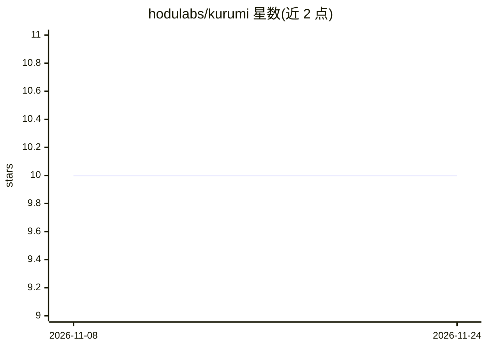

# hodulabs/kurumi

⭐ 10 · Rust · Apache-2.0 · 推送 2026-07-14 · [GitHub](https://github.com/hodulabs/kurumi) · [官网](https://git.daminstudio.net/dms.hodulabs/kurumi) · 个人维护

**给深度学习开发者的 Rust 张量与自动微分引擎**

hodu 背后的张量引擎：小型封闭原语 IR 配参考解释器、反向模式自动微分、视图融合 CPU 后端与 Apple Silicon Metal 后端，并提供 Rust API 与稳定 C ABI。设计上以纯 CPU 解释器作为正确性基准，其余后端与优化均对照其校验。17 种 dtype、计数器 RNG 与 IR 混合精度等内置。目前处于早期开发阶段，Metal 后端仅限 Apple Silicon 上的 macOS。

## 筛选速览

| 维度 | 判定 | 备注 |
|---|---|---|
| AI 角色 | `ai-native` | 本体是模型或模型工具 |
| 许可风险 | `permissive` | Apache-2.0 |
| 部署形态 | `None` |  |
| 模型依赖 | — | README 未给出锁定关系 |
| 硬件要求 | — | 无带数字的原话,不猜 |
| 安装摩擦 | `low` | 无编译、无系统依赖或容器化 |
| 成熟度 | `idea` | |

## 能力要点

- 封闭原语 IR，softmax/attention/conv/FFT 等高层算子分解到固定原语集
- CPU 解释器作为正确性基准，所有后端对照校验
- 反向模式自动微分与 17 种 dtype（含 f8/bf16/复数）
- Rust API 加稳定 C ABI，覆盖全部构建算子与 dtype

## 适用场景

- 在 Rust 项目中构建需要自动微分的张量计算
- 在 Apple Silicon 上通过 Metal 后端运行 GPU 计算
- 通过 C ABI 从 C/C++ 调用张量与求值功能

## 场景标签

 · 领域:机器学习/深度学习框架

## 证据(README 行号)

> L5: The tensor engine behind hodu: a small closed-primitive IR with a reference interpreter, reverse-mode autograd, a vi
> L13: - **Closed primitive IR.** High-level ops (softmax, attention, conv, FFTs, linear algebra) decompose to a small fix
> L16: - **Batteries in the core.** Reverse-mode autograd, 17 dtypes (bool, integers, f8/f16/bf16/f32/f64, complex), count

## 星数曲线

2026-11-08 10 → 2026-11-24 10（+0）

---
*卡片 v1 · prompt 1.4 · 生成 2026-11-19 · 置信度 high · 依据 README sha `2571ed6c2139` · [字段定义](../../DATASET.md)*
