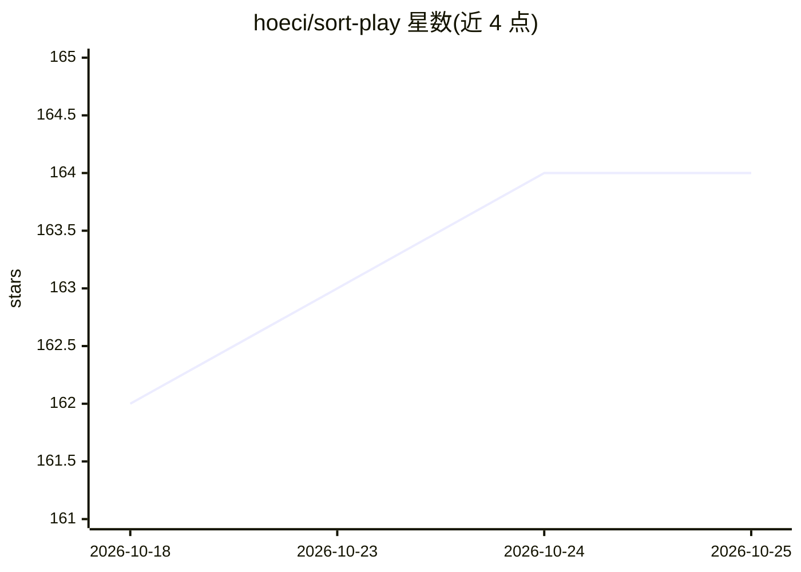

# hoeci/sort-play

⭐ 164 · JavaScript · MIT · 推送 2026-10-23 · [GitHub](https://github.com/hoeci/sort-play) · 个人维护

**给 Spotify 用户的桌面客户端增强扩展：排序/过滤/歌单生成**

一个 Spicetify 扩展，安装于 Spotify 桌面客户端，提供歌单/专辑/艺术家页面的多维排序（播放次数、Last.fm scrobbles、发行日期、BPM、能量等音频特征、口味匹配）、快捷过滤（去重、不可播曲目、关注艺人等）、额外数据列、右键菜单（全目录生成、流派查看）、艺人感知随机播放、以及一键生成和自更新的专用/动态歌单。部分功能需要 Last.fm 用户名。README 提供安装章节，具体命令在可见范围外。

## 筛选速览

| 维度 | 判定 | 备注 |
|---|---|---|
| AI 角色 | `ai-enhanced` | 去掉 AI 部分产品仍成立 |
| 许可风险 | `permissive` | MIT |
| 部署形态 | `None` |  |
| 模型依赖 | — | README 未给出锁定关系 |
| 硬件要求 | — | 无带数字的原话,不猜 |
| 安装摩擦 | `low` | 无编译、无系统依赖或容器化 |
| 成熟度 | — | 结构信号不足 |

## 能力要点

- 按播放次数、scrobbles、音频特征（BPM/能量/调性）等 20+ 指标排序
- 交互式重复曲目管理与智能去重（ISRC 匹配）
- 基于收听历史与 Last.fm 的发现/口味歌单一键生成
- 可设定时任务的自更新动态歌单

## 适用场景

- 清理歌单中的重复与不可播曲目
- 按 BPM/能量等音频特征整理 DJ 或连续听歌的歌单
- 自动生成并定时更新新发行/发现类歌单

## 场景标签

 · 领域:音乐/桌面客户端扩展

## 证据(README 行号)

> L5: *A Spicetify extension that adds powerful sorting, filtering, UI features, and more to the Spotify desktop client.*
> L29: * **Taste Match:** Sorts tracks by how well they align with your unique listening history and personal taste profil
> L115:  * **Recent Taste:** Recommendations based on your recent listening habits.

## 星数曲线

2026-10-18 162 → 2026-10-25 164（+2）

---
*卡片 v1 · prompt 1.4 · 生成 2026-10-22 · 置信度 low · 依据 README sha `38e176d07194` · [字段定义](../../DATASET.md)*
