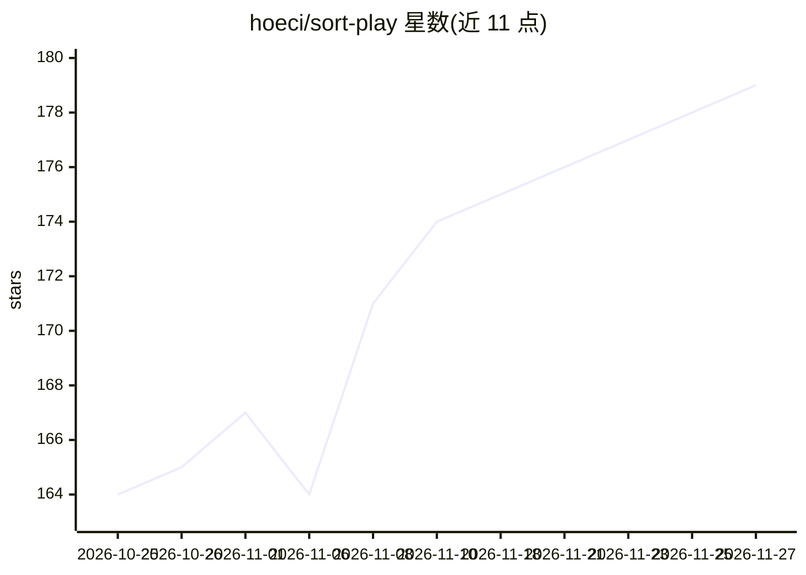

# hoeci/sort-play

⭐ 179 · JavaScript · MIT · 推送 2026-11-26 · [GitHub](https://github.com/hoeci/sort-play) · 个人维护

**为 Spotify 桌面客户端添加排序、过滤与播放列表生成功能的 Spicetify 扩展**

以 Spicetify 扩展形式运行于 Spotify 桌面客户端，提供按播放量、发行日期、Last.fm 收听记录、BPM 等音频特征排序，重复曲目检测与交互式审查清理，多列数据展示，按艺术家加载完整作品集并去重，以及自动更新的专属播放列表与多来源动态播放列表。功能依赖 Spotify 账号，部分排序与数据需 Last.fm 用户名。README 未提供安装命令之外的运行细节。

## 筛选速览

| 维度 | 判定 | 备注 |
|---|---|---|
| AI 角色 | `ai-enhanced` | 去掉 AI 部分产品仍成立 |
| 许可风险 | `permissive` | MIT |
| 部署形态 | `None` |  |
| 模型依赖 | — | README 未给出锁定关系 |
| 硬件要求 | — | 无带数字的原话,不猜 |
| 安装摩擦 | `low` | 无编译、无系统依赖或容器化 |
| 成熟度 | — | 结构信号不足 |

## 能力要点

- 按播放量、True Release Date、Last.fm 收听量、音频特征（BPM/能量/舞曲度等）多维度排序
- 重复曲目管理器：精确/疑似重复检测、ISRC 对比、音频预览与多种清理动作
- 艺术家完整作品集自动加载与可配置去重模式
- 一键生成 Top Tracks、新发行、Discovery Mixes 等播放列表并支持定时自动更新

## 适用场景

- 整理和清理 Spotify 播放列表中的重复与不可播放曲目
- 按发行日期或音频特征重新排序歌单和专辑
- 基于 Last.fm 收听历史生成发现类播放列表

## 场景标签

 · 领域:音乐/桌面工具

## 证据(README 行号)

> L5: *A Spicetify extension that adds powerful sorting, filtering, UI features, and more to the Spotify desktop client.*
> L29: * **Taste Match:** Sorts tracks by how well they align with your unique listening history and personal taste profil

## 星数曲线

2026-10-25 164 → 2026-11-27 179（+15）

---
*卡片 v1 · prompt 1.4 · 生成 2026-11-26 · 置信度 mid · 依据 README sha `a5838fb592be` · [字段定义](../../DATASET.md)*
