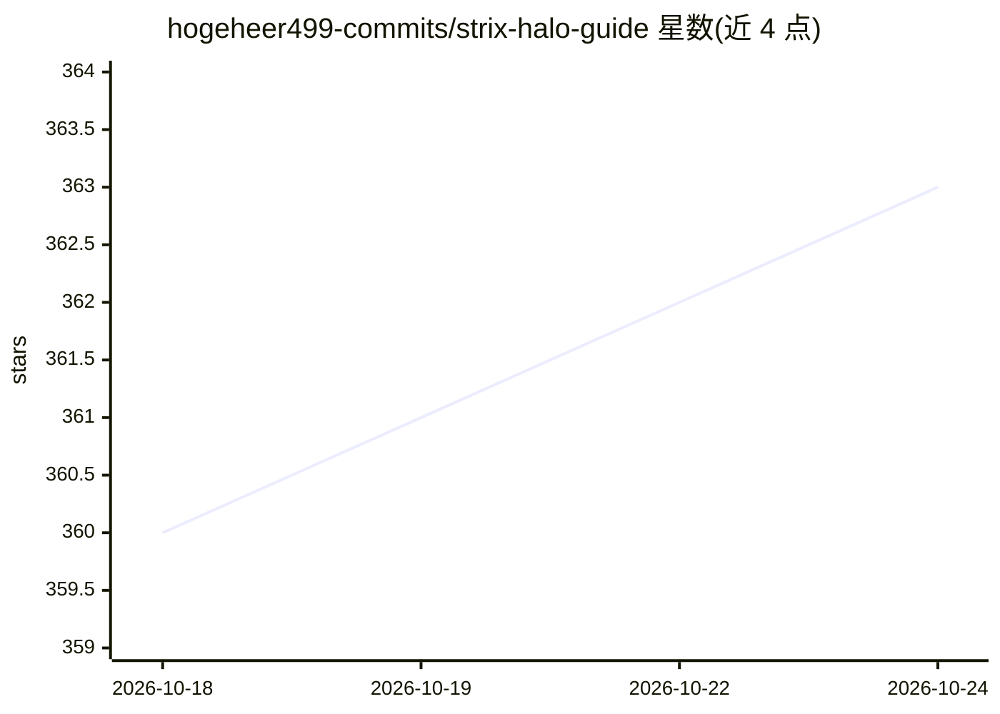

# hogeheer499-commits/strix-halo-guide

⭐ 363 · Python · MIT · 推送 2026-10-21 · [GitHub](https://github.com/hogeheer499-commits/strix-halo-guide) · [官网](https://strixhaloguide.com/) · 个人维护

**AMD Strix Halo 本地 LLM 配置指南与基准证据库**

面向 AMD Ryzen AI MAX+ 395（Radeon 8060S, gfx1151, 96/128GB 统一内存）用户的实操指南仓库：覆盖 BIOS 配置、Ubuntu 24.04/内核设置、Ollama 与 llama.cpp Vulkan/RADV 安装、ROCm/HIP 与 vLLM 实验、70B/120B 及 284B GGUF 容量验证、基准数据与原始日志。每条 headline 声明链接到 CSV、原始日志或明确标注 n/a，跨 13 个系统/独立来源的社区结果与第一方 Beelink 数据分开保存。仅提供文档、脚本、数据与图表，不含可执行文件或模型权重；自动化 setup.sh 仅限 128GB 级 Ubuntu 24.04 系统。

## 筛选速览

| 维度 | 判定 | 备注 |
|---|---|---|
| AI 角色 | `ai-knowledge` | 知识聚合/清单类 |
| 许可风险 | `permissive` | MIT |
| 部署形态 | `desktop` | 安装包/桌面程序 |
| 模型依赖 | local-ok | 支持本地模型 |
| 硬件要求 | — | 无带数字的原话,不猜 |
| 安装摩擦 | `low` | 无编译、无系统依赖或容器化 |
| 成熟度 | `idea` | |

## 能力要点

- 可复制的 Ubuntu + Vulkan/RADV 的 Ollama 与 llama.cpp 配置流程
- 基准声明逐条链接 CSV/原始日志/图表或显式 n/a，保留失败与更正记录
- 跨 13 个系统与 10 位社区贡献者的跨 OEM 证据，与本地数据分离
- Qwen3.8 27B 经 Ollama API 实测 20.42 t/s（含默认 MTP drafting）并附对照实验

## 适用场景

- 我在 Strix Halo 小主机上搭建本地 LLM 推理环境
- 我需要判断某个大模型（70B-284B）能否在这类统一内存机器上跑
- 我想复现或核对基准数据再决定购买哪款 OEM 机器

## 场景标签

`教程课程` · 领域:学习与行业

## 证据(README 行号)

> L14: A complete, practical guide to running large language models locally on AMD Strix Halo / Ryzen AI MAX+ 395 systems 
> L16: Covers BIOS config, Ubuntu 24.04/kernel setup, Ollama, `llama.cpp` Vulkan/RADV, ROCm/HIP experiments, vLLM notes, 7
> L59: > Measured primarily on one Beelink GTR9 Pro. Community results are kept separate from local headline claims. This 

## 星数曲线

2026-10-18 360 → 2026-10-24 363（+3）

---
*卡片 v1 · prompt 1.4 · 生成 2026-10-21 · 置信度 high · 依据 README sha `e2b4b6e0c92e` · [字段定义](../../DATASET.md)*
