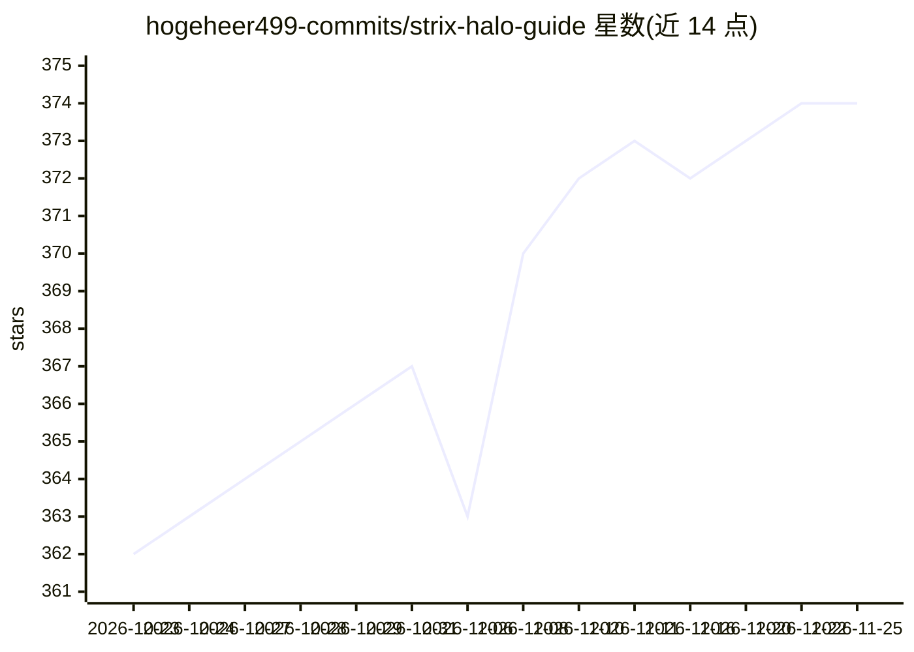

# hogeheer499-commits/strix-halo-guide

⭐ 374 · Python · MIT · 推送 2026-11-22 · [GitHub](https://github.com/hogeheer499-commits/strix-halo-guide) · [官网](https://strixhaloguide.com/) · 个人维护

**面向 Strix Halo 设备的本地 LLM 安装脚本与实测基准指南**

针对 AMD Ryzen AI MAX+ 395（128GB 统一内存）设备的本地 LLM 部署指南与基准数据集：提供六步 Quick Start 与 setup.sh 脚本（修改 GRUB 启动参数、升级 Mesa/RADV、配置 Ollama Vulkan 环境变量），附带 boot/answer 检查脚本验证模型是否 100% 跑在 GPU 上。基准行均为单流实测并附原始日志；社区结果独立收录，覆盖 13 台不同 OEM 设备，并给出 RPC、MTP、IOMMU 等经验规则。限制：脚本仅适用于 Ubuntu 24.04、120–136GiB 内存机型，无自动回滚。

## 筛选速览

| 维度 | 判定 | 备注 |
|---|---|---|
| AI 角色 | `ai-knowledge` | 知识聚合/清单类 |
| 许可风险 | `permissive` | MIT |
| 部署形态 | `desktop` | 安装包/桌面程序 |
| 模型依赖 | local-ok | 支持本地模型 |
| 硬件要求 | — | 无带数字的原话,不猜 |
| 安装摩擦 | `medium` | 含编译或系统依赖之一 |
| 成熟度 | — | 结构信号不足 |

## 能力要点

- 提供 128GB 机型的一键 setup.sh 与 boot/answer 自动检查脚本
- 基准行附原始日志，单流直测 llama-bench
- 收录 13 台 Strix Halo 系统的社区实测数据
- 总结 RPC、MTP/投机解码、IOMMU 策略等经验规则

## 适用场景

- 在 Strix Halo 迷你主机上把 Qwen 等模型配置为 100% GPU 运行
- 购机前按 RAM 大小与任务选择合适模型
- 排查 Vulkan/CPU fallback 等部署问题

## 场景标签

`模型评测` · 领域:评测与运维

## 证据(README 行号)

> L1: # Strix Halo Guide: AMD Ryzen AI MAX+ 395 Local LLM Setup & Benchmarks
> L10: This guide gives you one setup script and measurements from one 128GB Beelink GTR9 Pro. Community results are kept 
> L29: Run a local LLM on the GPU of a 128GB AMD Strix Halo / Ryzen AI MAX+ 395 (Radeon 8060S) with Ubuntu 24.04, Ollama a

## 星数曲线

2026-10-23 362 → 2026-11-25 374（+12）

---
*卡片 v1 · prompt 1.4 · 生成 2026-11-25 · 置信度 high · 依据 README sha `a7c986093368` · [字段定义](../../DATASET.md)*
