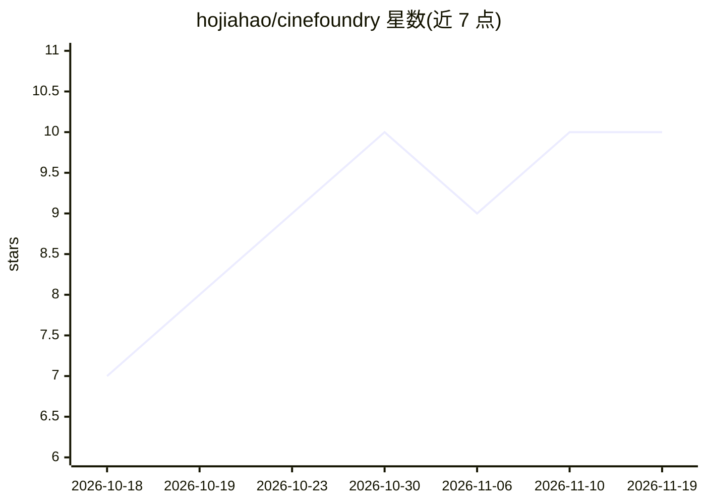

# hojiahao/cinefoundry

⭐ 10 · TypeScript · NOASSERTION · 推送 2026-10-19 · [GitHub](https://github.com/hojiahao/cinefoundry) · 个人维护 · 中文 README

**在单台 DGX Spark 上运行的 agent 电影制片厂：一句话生成成片**

Cinefoundry 在单台 NVIDIA DGX Spark 上以 26 个角色 agent（创意总监、编剧、摄影、选角、配音、剪辑、合规审查、QC 等）把一句话 brief 流水线化为成片，覆盖广告片、短视频、竖屏短剧三种格式。关键机制：阶段间设视觉门控（Step3-VL 比对锁定参考帧）、Whisper 逐句转写校验台词、生成前合规扫描（广告法/微短剧规则/AI 标识 GB 45438-2025）、代码侧确定性校验器打回不合格草稿。数据全程留在本机，云路由需手动开启。需 Node 22+，通过脚本安装并下载权重。

## 筛选速览

| 维度 | 判定 | 备注 |
|---|---|---|
| AI 角色 | `ai-native` | 本体是模型或模型工具 |
| 许可风险 | `none` | NOASSERTION |
| 部署形态 | `None` |  |
| 模型依赖 | local-ok | 支持本地模型 |
| 硬件要求 | — | 无带数字的原话,不猜 |
| 安装摩擦 | `medium` | 含编译或系统依赖之一 |
| 成熟度 | — | 结构信号不足 |

## 能力要点

- 26 个角色 agent 的 Agent Skills 开放格式，可由 Claude Code、Codex、DeepSeek Harness 等客户端驱动 CLI
- 每帧视觉门控与每句台词 Whisper 校验的质检流水线
- CPU/GPU 共享 121.7 GB 统一内存的按阶段模型加载与释放调度
- 含技能前后对比的评测数据与 `cinefoundry eval` 复现命令

## 适用场景

- 一句话生成 30 秒广告片及多版本剪辑
- 为抖音、B站、YouTube Shorts 生成带包装的短视频
- 按集生成竖屏微短剧系列
- 用合规扫描器检查广告法违禁词文案

## 场景标签

`视频生成` `多智能体` · 领域:Agent 开发

## 证据(README 行号)

> L20: **Cinefoundry is an agentic film studio that runs on a single NVIDIA DGX Spark. One idea in, a finished film out.**
> L22: A crew of AI agents — creative director, screenwriter, director of photography, casting, voice director, sound desi
> L46: - **One engine, many formats.** The Cinefoundry Engine (`src/engine`) owns what every production needs: preflight, 

## 星数曲线

2026-10-18 7 → 2026-11-19 10（+3）

---
*卡片 v1 · prompt 1.4 · 生成 2026-11-19 · 置信度 high · 依据 README sha `8dd50003fd0d` · [字段定义](../../DATASET.md)*
