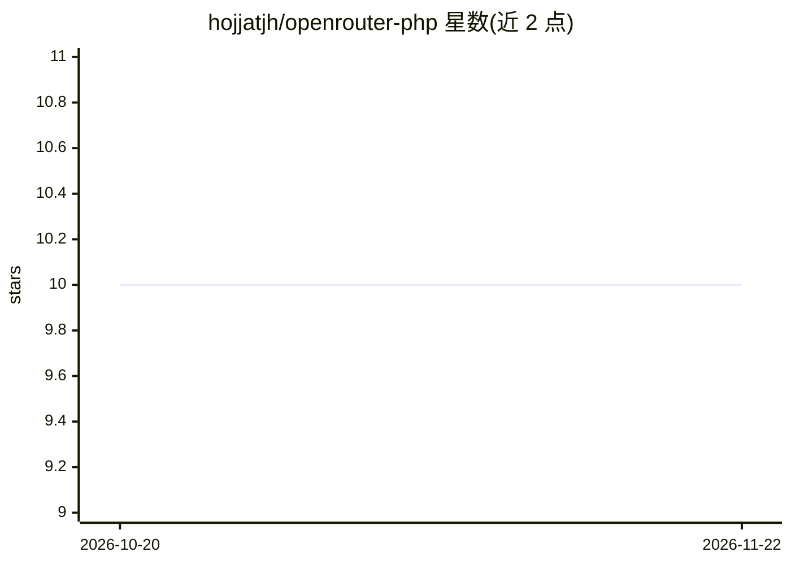

# hojjatjh/openrouter-php

⭐ 10 · PHP · MIT · 推送 2026-07-19 · [GitHub](https://github.com/hojjatjh/openrouter-php) · 个人维护 · 中文 README

**面向 PHP 开发者的 OpenRouter API 全类型客户端 SDK**

强类型、零依赖的 PHP 客户端，封装 OpenRouter 网关以访问多家提供商的数百个模型。功能覆盖聊天补全、SSE 流式输出、工具/函数调用、JSON Schema 结构化输出、带磁盘持久化的对话记忆、知识库注入、指数退避自动重试，以及模型列表/余额/费用统计等辅助端点。网络层抽象在 Transport 接口之后，可注入假实现做无网络测试。要求 PHP 8.1+ 与 ext-curl、ext-json，通过 Composer 安装。

## 筛选速览

| 维度 | 判定 | 备注 |
|---|---|---|
| AI 角色 | `ai-ecosystem` | LLM/agent 周边工具 |
| 许可风险 | `permissive` | MIT |
| 部署形态 | `None` |  |
| 模型依赖 | locked-api |  |
| 硬件要求 | — | 无带数字的原话,不猜 |
| 安装摩擦 | `low` | 无编译、无系统依赖或容器化 |
| 成熟度 | — | 结构信号不足 |

## 能力要点

- 支持聊天、流式、工具调用、结构化 JSON 输出等完整功能集
- 对话记忆支持磁盘持久化，可自定义 ConversationStore 存储后端
- Transport 接口隔离网络层，测试时可完全 mock
- 按 HTTP 状态码提供专属异常类，自动重试仅限瞬时错误

## 适用场景

- 在 PHP 项目中通过单一 API 接入多家模型提供商
- 为 PHP 应用添加带持久化上下文的多轮对话能力
- 需要对模型输出做 JSON Schema 校验的结构化场景

## 场景标签

`模型网关` · 领域:Agent 开发

## 证据(README 行号)

> L16: OpenRouter gives you a single, OpenAI-compatible gateway to hundreds of models from many providers. **OpenRouter PH
> L27: - **Testable by design.** The network layer sits behind a `Transport` interface, so your tests never touch the inte

## 星数曲线

2026-10-20 10 → 2026-11-22 10（+0）

---
*卡片 v1 · prompt 1.4 · 生成 2026-11-19 · 置信度 high · 依据 README sha `f6510751b194` · [字段定义](../../DATASET.md)*
