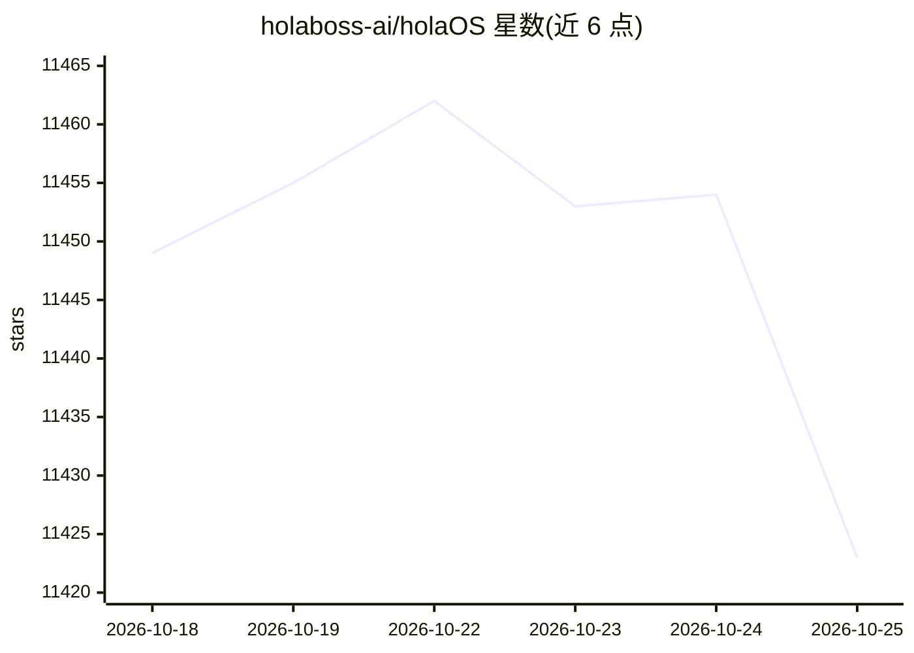

# holaboss-ai/holaOS

⭐ 11,423 · TypeScript · NOASSERTION · 推送 2026-10-24 · [GitHub](https://github.com/holaboss-ai/holaOS) · [官网](https://holaos.ai) · 组织维护

**本地优先的企业级 agentic 工作区：聚合应用、集成与多种 agent**

基于 Electron/TypeScript 的桌面 agentic 工作区，面向希望自行搭建工作流的企业团队。支持在工作区内安装应用并与 agent 并排操作、接入 Slack/飞书/钉钉/微信等聊天工具、通过 OAuth 连接 Gmail/Notion 等 50+ 集成与 MCP 服务器，并可运行 Claude Code、Codex 或内置 agent，共享本地明文存储的记忆。模型可使用内置供给或 BYOK 接入 OpenAI/Anthropic 及兼容端点。本地优先，数据留在本机；采用修改版 Apache 2.0 许可，含商业分发与品牌条款。提供一键安装脚本与 npm 手动安装流程，另有企业版（SSO、审计日志）描述。

## 筛选速览

| 维度 | 判定 | 备注 |
|---|---|---|
| AI 角色 | `ai-ecosystem` | LLM/agent 周边工具 |
| 许可风险 | `none` | NOASSERTION |
| 部署形态 | `library` | 以包/库形式分发 |
| 模型依赖 | — | README 未给出锁定关系 |
| 硬件要求 | — | 无带数字的原话,不猜 |
| 安装摩擦 | `low` | 无编译、无系统依赖或容器化 |
| 成熟度 | — | 结构信号不足 |

## 能力要点

- 100+ 集成与 MCP 服务器接入，agent 共享同一工具与记忆
- 可运行 Claude Code、Codex 或内置 agent，共享记忆/技能/应用
- 本地优先：工作区文件、记忆与会话历史以明文文件存于本机
- 支持 BYOK（OpenAI/Anthropic 及兼容端点）与内置模型供给

## 适用场景

- 把团队已有的聊天工具与 SaaS 集成接入统一 agent 工作区
- 在同一工作区并行运行不同 agent 并共享记忆与技能
- 在本地环境按需组装应用、技能与自动化流程

## 场景标签

`Agent 框架` · 领域:Agent 开发

## 证据(README 行号)

> L72: Claude Code, Codex, and the built-in holaOS agent — side by side, no switching. Whichever you run, it shares the sa
> L74: - **No lock-in** — run Claude Code, Codex, or holaOS's own agent in the same workspace, over the same tools, files,
> L56: - **MCP** — plug in any Model Context Protocol server to give your agents new tools. Bring your own, or install com

## 星数曲线

2026-10-18 11,449 → 2026-10-25 11,423（-26）

---
*卡片 v1 · prompt 1.4 · 生成 2026-10-20 · 置信度 high · 依据 README sha `f5dc64f1df8e` · [字段定义](../../DATASET.md)*
