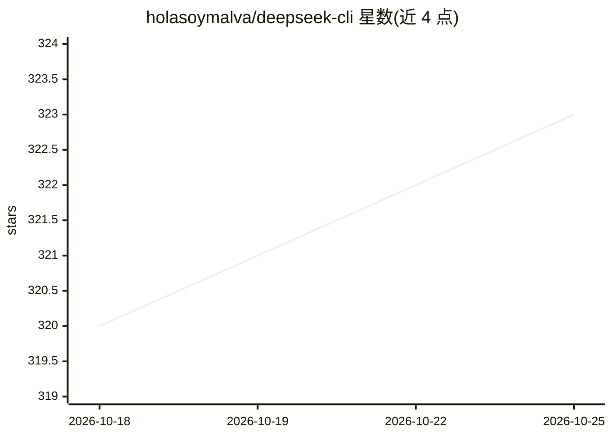

# holasoymalva/deepseek-cli

⭐ 324 · TypeScript · MIT · 推送 2026-07-23 · [GitHub](https://github.com/holasoymalva/deepseek-cli) · [官网](https://deepseek-cli.vercel.app/) · 个人维护

**调用 DeepSeek Coder 模型的命令行 AI 编程助手**

基于 TypeScript 的命令行 AI 编程助手，通过 DeepSeek API 或本地 Ollama 运行的 DeepSeek Coder 模型，提供代码补全生成、仓库级代码理解、重构迁移、调试与代码审查、项目脚手架等功能，声称覆盖 100+ 编程语言。默认本地模式（deepseek-coder:6.7b，需 8GB RAM），可切换云端 API key 模式。含交互式 REPL、语法高亮、会话历史与文件上下文，提供 setup 命令自动安装配置本地环境。以 npm 全局包为主要安装途径，另提供源码构建与 Docker 运行方式。

## 筛选速览

| 维度 | 判定 | 备注 |
|---|---|---|
| AI 角色 | `ai-native` | 本体是模型或模型工具 |
| 许可风险 | `permissive` | MIT |
| 部署形态 | `self-host` | docker 或自建部署 |
| 模型依赖 | local-ok | 支持本地模型 |
| 硬件要求 | — | 无带数字的原话,不猜 |
| 安装摩擦 | `low` | 无编译、无系统依赖或容器化 |
| 成熟度 | — | 结构信号不足 |

## 能力要点

- 本地 Ollama 与云端 DeepSeek API 双模式，默认本地运行
- 支持 1.3B/6.7B/33B 三档 DeepSeek Coder 模型选择
- deepseek setup 命令自动检测并安装 Ollama、下载模型
- 交互式 REPL：语法高亮、多轮对话、自动包含项目文件上下文

## 适用场景

- 在终端里对整个仓库做代码分析、重构与迁移
- 无 API key 时用本地模型离线完成代码生成与补全
- 让 AI 辅助代码审查、写单元测试和生成提交信息

## 场景标签

`代码生成` `代码审查` · 领域:编码与开发

## 证据(README 行号)

> L8: This repository contains the DeepSeek CLI, a command-line AI coding assistant that leverages the powerful DeepSeek C
> L12: - **Code Completion & Generation**: Get intelligent code suggestions and generate complete functions across 100+ pr
> L74: Once the CLI is running, you can start interacting with DeepSeek Coder from your shell.

## 星数曲线

2026-10-18 320 → 2026-10-25 323（+3）

---
*卡片 v1 · prompt 1.4 · 生成 2026-10-21 · 置信度 high · 依据 README sha `631d6da9a713` · [字段定义](../../DATASET.md)*
