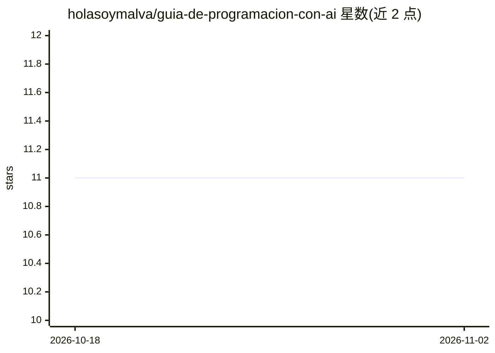

# holasoymalva/guia-de-programacion-con-ai

⭐ 11 · Python · MIT · 推送 2026-11-01 · [GitHub](https://github.com/holasoymalva/guia-de-programacion-con-ai) · 个人维护

**西班牙语 AI 编程开发指南：模块化教程与可运行项目**

面向西语开发者的 AI 编程学习指南：11 个理论-实践模块覆盖 LLM 概念、开发工具、Prompt Engineering、API 集成、AI Agent、RAG、微调与安全伦理；每个模块附练习与常见错误分析。另含 5 个可本地运行的 Python 项目（代码翻译 CLI、README 生成器、带记忆的终端聊天机器人、FastAPI 代码生成 API、ChromaDB 本地 RAG 管道），以及速查表与提示词模板。MIT 许可，接受社区贡献，附公开路线图。

## 筛选速览

| 维度 | 判定 | 备注 |
|---|---|---|
| AI 角色 | `ai-knowledge` | 知识聚合/清单类 |
| 许可风险 | `permissive` | MIT |
| 部署形态 | `None` |  |
| 模型依赖 | — | README 未给出锁定关系 |
| 硬件要求 | — | 无带数字的原话,不猜 |
| 安装摩擦 | `low` | 无编译、无系统依赖或容器化 |
| 成熟度 | — | 结构信号不足 |

## 能力要点

- 11 个模块化理论-实践章节（Prompt、Agent、RAG、微调、安全等）
- 5 个可本地运行的 Python 项目（含 ChromaDB 本地 RAG 管道）
- Prompt Engineering 速查表、System Prompt 与 .env 模板
- 面向西语社区，附 ROADMAP 与贡献指南

## 适用场景

- 从零学习用 AI 工具和 LLM API 开发软件
- 按模块自学 Prompt 工程、Agent 与 RAG 等主题
- 直接运行示例项目练习 AI 集成开发

## 场景标签

`教程课程` · 领域:学习与行业

## 证据(README 行号)

> L5: ### La guía más completa en español para desarrollar productos y software utilizando Inteligencia Artificial
> L22: Esta guía está organizada de manera modular para que puedas estudiar a tu propio ritmo. Cada módulo cuenta con expl

## 星数曲线

2026-10-18 11 → 2026-11-02 11（+0）

---
*卡片 v1 · prompt 1.4 · 生成 2026-11-02 · 置信度 high · 依据 README sha `d0e30f26667a` · [字段定义](../../DATASET.md)*
