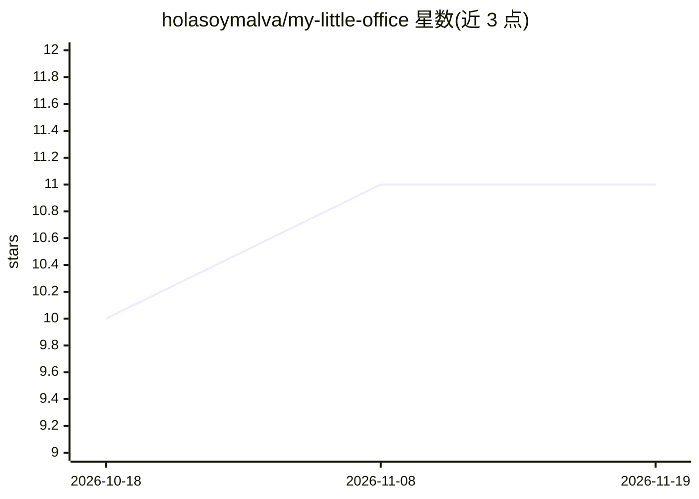

# holasoymalva/my-little-office

⭐ 11 · TypeScript · 推送 2026-08-30 · [GitHub](https://github.com/holasoymalva/my-little-office) · 个人维护

**像素风办公室界面，编排 AI 编码代理完成真实开发任务**

由两个进程组成：Next.js 仪表盘（可部署到 Cloudflare Workers）提供像素风办公室 UI，负责派发任务、观察进度与批准交付；本机 Node 运行时负责克隆仓库、修改文件、运行命令、提交推送并用 GitHub CLI 开 PR。代理的修改必须通过项目自身的 verify 检查，失败时最多两次自动修复；工作区为一次性克隆，路径逃逸与默认危险命令（curl/wget/ssh/sudo 等）被阻断。可对接 Linear 做需求导入与状态回写。安装需 npm 并配置至少一个模型供应商的 API key。

## 筛选速览

| 维度 | 判定 | 备注 |
|---|---|---|
| AI 角色 | `ai-ecosystem` | LLM/agent 周边工具 |
| 许可风险 | `none` | — |
| 部署形态 | `library` | 以包/库形式分发 |
| 模型依赖 | locked-api |  |
| 硬件要求 | — | 无带数字的原话,不猜 |
| 安装摩擦 | `medium` | 含编译或系统依赖之一 |
| 成熟度 | — | 结构信号不足 |

## 能力要点

- 每个办公室角色映射到 ChatGPT、Gemini 或 Grok 支撑的真实编码代理
- 任务流水线：克隆→规划→实现→验证→修复→提交→推送→开 PR
- 工作区隔离与 allowlist/denylist 命令管控，代理不可推送或发布
- Linear 集成：创建、导入、分配 issue 并同步状态

## 适用场景

- 把 bug 修复或新功能交给代理，自动产出带检查通过的 PR
- 通过办公室经理对话分派任务、注册项目、同步 Linear backlog
- 自动交付关闭时人工审查 diff 后再批准开 PR

## 场景标签

`编码 Agent` · 领域:编码与开发

## 证据(README 行号)

> L5: A pixel-art office where AI agents actually do the work. The dashboard is not a
> L17: |**Dashboard** (`app/`)|Next.js on Cloudflare Workers|The office UI. Assign tasks, watch agents work, approve deliv
> L18: |**Agent runtime** (`agent-runtime/`)|Node on your machine|Clones repos, edits files, runs commands, commits, pushe

## 星数曲线

2026-10-18 10 → 2026-11-19 11（+1）

---
*卡片 v1 · prompt 1.4 · 生成 2026-11-18 · 置信度 high · 依据 README sha `274874db5dd3` · [字段定义](../../DATASET.md)*
