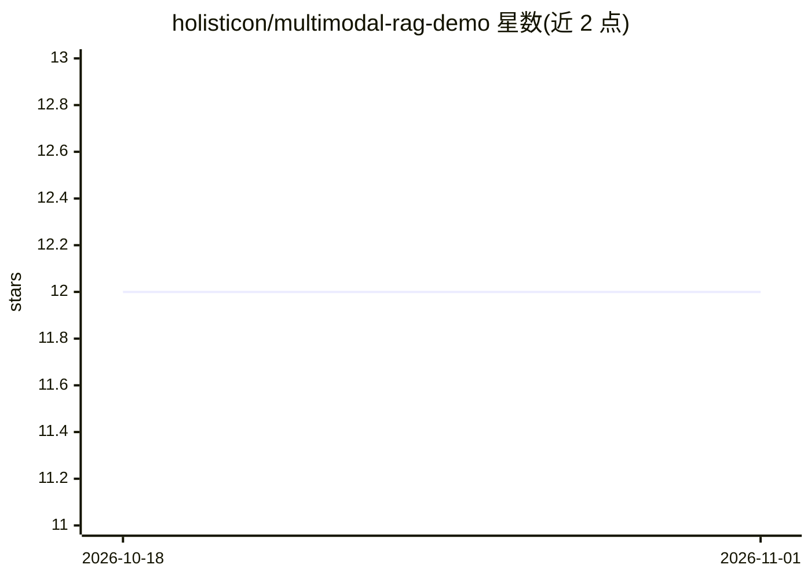

# holisticon/multimodal-rag-demo

⭐ 12 · Python · Apache-2.0 · 推送 2026-01-19 · [GitHub](https://github.com/holisticon/multimodal-rag-demo) · [官网](https://www.holisticon.de/services/data-analytics-ai) · 组织维护

**基于 Qwen3-VL 的多模态 RAG 演示：PDF/图片/文本统一索引检索**

以 Apache-2.0 的 Qwen3-VL Embedding 与 Reranker 模型构建的多模态 RAG 演示应用：将 PDF（页面图像+抽取文本）、图片和文本文件摄入同一索引，支持纯文本、图像或图文混合查询；可选开启带来源引用的回答生成，后端可为本地 transformers 或任意 OpenAI 兼容 API（如 LM Studio、远程 OpenAI）。提供 Web UI 与 CLI 参数配置（设备 auto/cuda/mps/cpu、量化 8bit/4bit、分块大小等），索引落盘以便快速重启。以 uv 运行的 Python 服务形式提供。

## 筛选速览

| 维度 | 判定 | 备注 |
|---|---|---|
| AI 角色 | `ai-ecosystem` | LLM/agent 周边工具 |
| 许可风险 | `permissive` | Apache-2.0 |
| 部署形态 | `None` |  |
| 模型依赖 | — | README 未给出锁定关系 |
| 硬件要求 | — | 无带数字的原话,不猜 |
| 安装摩擦 | `medium` | 含编译或系统依赖之一 |
| 成熟度 | — | 结构信号不足 |

## 能力要点

- PDF 页面图像与文本进入同一多模态索引，支持图像查询
- Qwen3-VL Embedding + 可切换的 Reranker 重排序
- 回答生成可选：本地 transformers 或 OpenAI 兼容 API
- 磁盘索引持久化与 Web UI（/ingest、/query）

## 适用场景

- 检索含图表/扫描页的 PDF 文档
- 用示例图片搜索索引中的相似页面
- 开启生成后获得带来源引用的回答

## 场景标签

`RAG` `多模态` · 领域:知识与检索

## 证据(README 行号)

> L38: - 🧲 Multimodal embeddings with **Qwen3-VL**
> L41: - ✍️ Optional **answer generation** with source context:
> L43:  - via an **OpenAI-compatible API** (local or remote)

## 星数曲线

2026-10-18 12 → 2026-11-01 12（+0）

---
*卡片 v1 · prompt 1.4 · 生成 2026-11-01 · 置信度 high · 依据 README sha `627b663cc2e3` · [字段定义](../../DATASET.md)*
