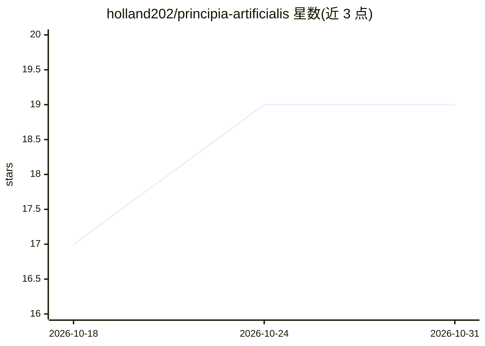

# holland202/principia-artificialis

⭐ 19 · Python · MIT · 推送 2026-10-30 · [GitHub](https://github.com/holland202/principia-artificialis) · [官网](https://holland202.github.io/principia-artificialis/) · 个人维护

**AI 数学基础的开源研究计划：可验证的研究笔记记录**

探索性研究计划（非验证产品），用信息几何、拓扑、动力系统、热力学、量子信息与范畴论方法研究神经系统的表示、推理与泛化。形式为科研笔记、实验协议、仿真脚本与图表的活记录：每条笔记带认知标签（Verified/Draft/Speculative/Refuted-kept），数字须由脚本打印，check_numbers.py 核对散文数字与脚本输出，被驳斥的预测保留在记录中。由 1 名人类与 5 个 AI 系统署名共同撰写，CI 重跑每条笔记的参考代码。

## 筛选速览

| 维度 | 判定 | 备注 |
|---|---|---|
| AI 角色 | `ai-knowledge` | 知识聚合/清单类 |
| 许可风险 | `permissive` | MIT |
| 部署形态 | `library` | 以包/库形式分发 |
| 模型依赖 | — | README 未给出锁定关系 |
| 硬件要求 | — | 无带数字的原话,不猜 |
| 安装摩擦 | `low` | 无编译、无系统依赖或容器化 |
| 成熟度 | `idea` | |

## 能力要点

- 每条笔记携带认知标签，被驳斥的预测保留并标记
- check_numbers.py 核对散文中的数字与脚本输出（历史审计 145/216）
- 笔记模板 + CI 重跑参考代码的贡献流程，人类与 AI 署名平等
- 自声明为探索性研究计划而非已验证理论，负面结果置顶公布

## 适用场景

- 复现或反驳笔记中的数学计算与预测
- 作为独立研究者以自己的问题加入开放式研究
- 研究 AI 作为物理/数学现象的可测量性假设

## 场景标签

`科研工具` · 领域:学习与行业

## 证据(README 行号)

> L97: **An open research program on the mathematical foundations of artificial
> L182: Principia Artificialis investigates artificial intelligence as a
> L188: This is not an engineering repository. It is a living scientific

## 星数曲线

2026-10-18 17 → 2026-10-31 19（+2）

---
*卡片 v1 · prompt 1.4 · 生成 2026-10-28 · 置信度 mid · 依据 README sha `b9a828ecf185` · [字段定义](../../DATASET.md)*
