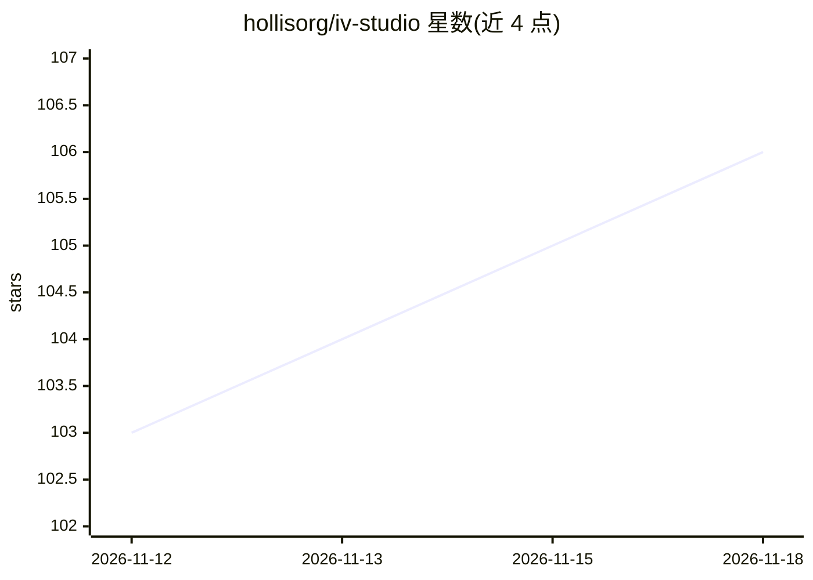

# hollisorg/iv-studio

⭐ 106 · JavaScript · MIT · 推送 2026-11-17 · [GitHub](https://github.com/hollisorg/iv-studio) · [官网](https://infinitevariance.ai/studio) · 组织维护

**本地 AI 短片制作桌面应用：固定角色演员+剪辑+语音音乐**

Infinite Variance 出品的免费开源桌面应用，用于在本地 PC 制作短片：给固定角色（recurring actor）配置面孔与声音，编写镜头、生成预览并全尺寸成片，支持 MiniMax H3、Seedance 2.5、MiniMax H3 Image 等模型，通过驱动本地 ComfyUI 渲染，也可选用 RunPod/Modal/Comfy Cloud 云 GPU。内置图像、音乐、配音生成与视频剪辑器，提供 217 个 MCP 工具供 Claude Code、Codex、Hermes 等 agent 操作，聊天也支持本地 Ollama 模型与 Whisper 离线语音识别。提供 Windows/macOS/Linux 安装包。

## 筛选速览

| 维度 | 判定 | 备注 |
|---|---|---|
| AI 角色 | `ai-native` | 本体是模型或模型工具 |
| 许可风险 | `permissive` | MIT |
| 部署形态 | `desktop` | 安装包/桌面程序 |
| 模型依赖 | local-ok | 支持本地模型 |
| 硬件要求 | — | 无带数字的原话,不猜 |
| 安装摩擦 | `medium` | 含编译或系统依赖之一 |
| 成熟度 | — | 结构信号不足 |

## 能力要点

- 固定角色（面孔+声音）跨镜头生成，MiniMax H3 / Seedance 2.5 视频与图像生成
- 驱动本地 ComfyUI 渲染，数据不离开本机，可选 RunPod/Modal/Comfy Cloud 云 GPU
- 217 个 MCP 工具供 Claude Code / Codex / Hermes 操作，聊天支持本地 Ollama
- 内置剪辑器、配音/音乐/音效生成、Whisper 离线语音输入与字幕

## 适用场景

- 在本地电脑制作带固定角色形象的 AI 短片
- 通过对话让 Claude Code 等 agent 代为写提示词、渲染与管理剪辑
- 没有强显卡时改用按秒计费的自有云 GPU 渲染

## 场景标签

`视频生成` `图像生成` `语音合成` · 领域:内容生成

## 证据(README 行号)

> L19: A free Infinite Variance desktop app for making short films with
> L20: MiniMax H3 on your own PC. Give a recurring actor a face
> L22: pictures, songs and spoken lines, cut it all together and export. IV Studio drives your own

## 星数曲线

2026-11-12 103 → 2026-11-18 106（+3）

---
*卡片 v1 · prompt 1.4 · 生成 2026-11-17 · 置信度 high · 依据 README sha `6367fcf64a9d` · [字段定义](../../DATASET.md)*
