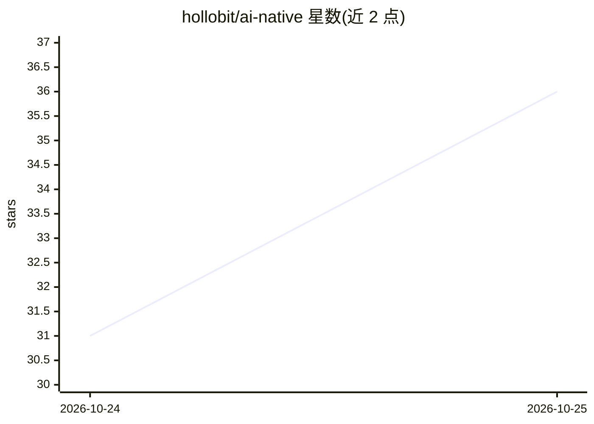

# hollobit/ai-native

⭐ 36 · HTML · NOASSERTION · 推送 2026-10-24 · [GitHub](https://github.com/hollobit/ai-native) · 个人维护

**韩文电子书《AI 原生手册 2026》：以电力比喻讲解 AI 原生时代**

作者 전종홍（全钟洪）撰写的 415 页韩文书籍，以『电力—智能』类比阐述 AI 原生时代：将基础模型比作发电厂、MCP/A2A 比作输电网、AI 代理比作家电，并讨论企业与国家的应对布局。以 PDF 与 EPUB 格式通过 GitHub Pages 分发，新版本发布后由 GitHub Actions 自动部署，定位为持续修订的活文档。采用 CC BY-NC-ND 4.0 许可，禁止商用与二次创作，商业用途需另行联系作者。

## 筛选速览

| 维度 | 判定 | 备注 |
|---|---|---|
| AI 角色 | `ai-knowledge` | 知识聚合/清单类 |
| 许可风险 | `none` | NOASSERTION |
| 部署形态 | `None` |  |
| 模型依赖 | — | README 未给出锁定关系 |
| 硬件要求 | — | 无带数字的原话,不猜 |
| 安装摩擦 | `low` | 无编译、无系统依赖或容器化 |
| 成熟度 | — | 结构信号不足 |

## 能力要点

- 415 页 PDF 与 EPUB 电子书，经 GitHub Pages 分发
- 以电力系统类比（发电厂/输电网/家电）讲解 AI 技术栈
- living document 模式，记录版本修订历史
- CC BY-NC-ND 4.0 许可，含韩英许可条款说明

## 适用场景

- 系统性了解 AI 原生时代的组织与国家战略
- 在电子书设备上离线阅读 AI 主题内容
- 追踪作者持续修订的最新版本

## 场景标签

`教程课程` · 领域:学习与行业

## 证据(README 行号)

> L1: # 지능을 전기처럼 쓰는 시대 — AI 네이티브 핸드북 2026
> L15: 석탄이 증기를, 석유가 전기를 불러왔듯 이제 전기는 지능이 됩니다. 이 책은 파운데이션 모델을 발전소로, MCP·A2A를 송전망으로, AI 에이전트를 가전제품으로 보는 하나의 비유로 AI 네이티브 시대를 풀
> L21: |PDF (415쪽, 브라우저에서 바로 열림)|hollobit.github.io/ai-native/book.pdf|

## 星数曲线

2026-10-24 31 → 2026-10-25 36（+5）

---
*卡片 v1 · prompt 1.4 · 生成 2026-10-25 · 置信度 high · 依据 README sha `bd63046f202b` · [字段定义](../../DATASET.md)*
