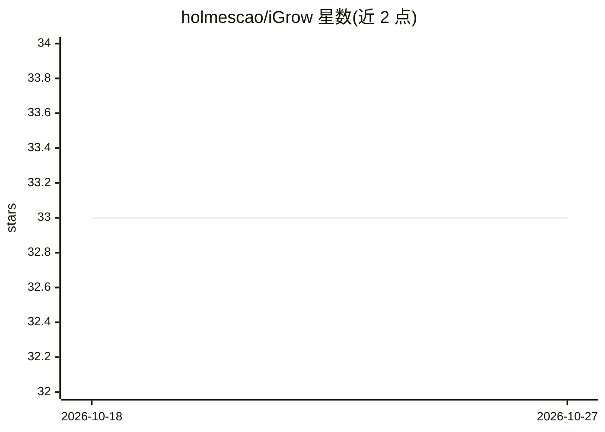

# holmescao/iGrow

⭐ 33 · Python · MIT · 推送 2026-03-22 · [GitHub](https://github.com/holmescao/iGrow) · [官网](https://ojs.aaai.org/index.php/AAAI/article/view/21440) · 组织维护

**AAAI2022 论文官方代码：自主温室控制的智能农业方案**

iGrow 论文（AAAI2022）的官方复现仓库，包含全部数据与代码。内容为：将自主温室控制建模为 MDP 优化问题，用带增量机制的神经网络模拟器模拟完整种植过程，并以闭环双层优化算法（SAC 与 EGA）动态重优化控制策略。README 提供六个一键脚本复现论文表格与图表结果，另有重新训练模拟器与算法的可选流程。兼容 Python 3.6，依赖 CUDA 10.2、PyTorch 1.7.1 与 geatpy 2.5.1，已部署于真实温室番茄试点。

## 筛选速览

| 维度 | 判定 | 备注 |
|---|---|---|
| AI 角色 | `ai-native` | 本体是模型或模型工具 |
| 许可风险 | `permissive` | MIT |
| 部署形态 | `library` | 以包/库形式分发 |
| 模型依赖 | — | README 未给出锁定关系 |
| 硬件要求 | — | 无带数字的原话,不猜 |
| 安装摩擦 | `medium` | 含编译或系统依赖之一 |
| 成熟度 | — | 结构信号不足 |

## 能力要点

- 神经网络模拟器（含增量机制）模拟完整温室种植过程
- 闭环双层优化算法（SAC/EGA）动态重优化控制策略
- 六个脚本复现论文全部表格与图表结果
- 已在真实温室番茄试点部署（论文报告产量 +10.15%）

## 适用场景

- 复现 AAAI2022 iGrow 论文的实验结果
- 重新训练温室模拟器与控制策略算法
- 研究自主温室控制的 MDP 建模与优化方法

## 场景标签

`强化学习` · 领域:训练与推理

## 证据(README 行号)

> L12: ## Abstract
> L94: python train_simulator.py
> L105: python sac_main.py

## 星数曲线

2026-10-18 33 → 2026-10-27 33（+0）

---
*卡片 v1 · prompt 1.4 · 生成 2026-10-25 · 置信度 mid · 依据 README sha `64c266d2bd7d` · [字段定义](../../DATASET.md)*
