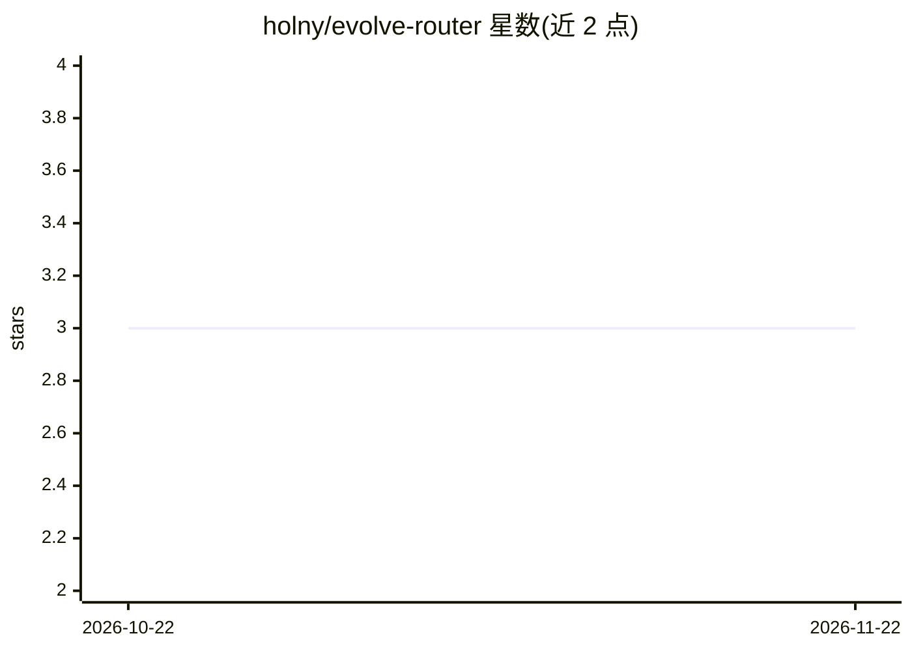

# holny/evolve-router

⭐ 3 · Rust · MIT · 推送 2026-11-01 · [GitHub](https://github.com/holny/evolve-router) · 个人维护 · 中文 README

**本地 LLM 路由网关：按请求评估并自动选择合适模型**

面向 agent 场景的本地 LLM 路由网关，以单个 Rust 二进制运行，含 macOS 菜单栏面板与零构建 dashboard，数据不离开本机。每个请求由可插拔决策模型读取八类信号（难度、视觉需求、工具密度等），经硬过滤、动态权重、五因子评分与 Thompson 探索选出模型，结果回灌形成反馈回路；内置多语言启发式裁判兜底，决策模型不可用时规则接管。提供回测命令校验策略参数变更，事件日志记录全部决策量。

## 筛选速览

| 维度 | 判定 | 备注 |
|---|---|---|
| AI 角色 | `ai-ecosystem` | LLM/agent 周边工具 |
| 许可风险 | `permissive` | MIT |
| 部署形态 | `None` |  |
| 模型依赖 | — | README 未给出锁定关系 |
| 硬件要求 | — | 无带数字的原话,不猜 |
| 安装摩擦 | `medium` | 含编译或系统依赖之一 |
| 成熟度 | — | 结构信号不足 |

## 能力要点

- 八信号判分 + 五因子（质量/速度/成本/可靠性/余量）路由
- 四层反馈回路的自我进化机制，策略变更须通过回测
- OpenAI 与 Anthropic 双向协议翻译，一个端点 model=auto
- 提供商健康分级与回退扫描，失败与低质响应自动升级下一候选

## 适用场景

- 让 Claude Code/Codex 等 agent 按请求难度自动分配模型
- 多提供商多订阅计划下的成本感知模型调度
- 本地审计每条路由决策与反馈数据的私有化部署

## 场景标签

`模型网关` `编码 Agent` · 领域:Agent 开发

## 证据(README 行号)

> L13: EvolveRouter is a **local LLM routing gateway** for agents. Every request is judged on eight signals, priced in its
> L55: OpenAI-compatible clients use `http://127.0.0.1:8787/v1` with model `auto`; Claude Code and other Anthropic clients
> L70: |**Judge**|A pluggable **decision model** reads the request (domain, difficulty, vision need, triviality, tool dens

## 星数曲线

2026-10-22 3 → 2026-11-22 3（+0）

---
*卡片 v1 · prompt 1.4 · 生成 2026-11-21 · 置信度 high · 依据 README sha `f9eb34f14779` · [字段定义](../../DATASET.md)*
