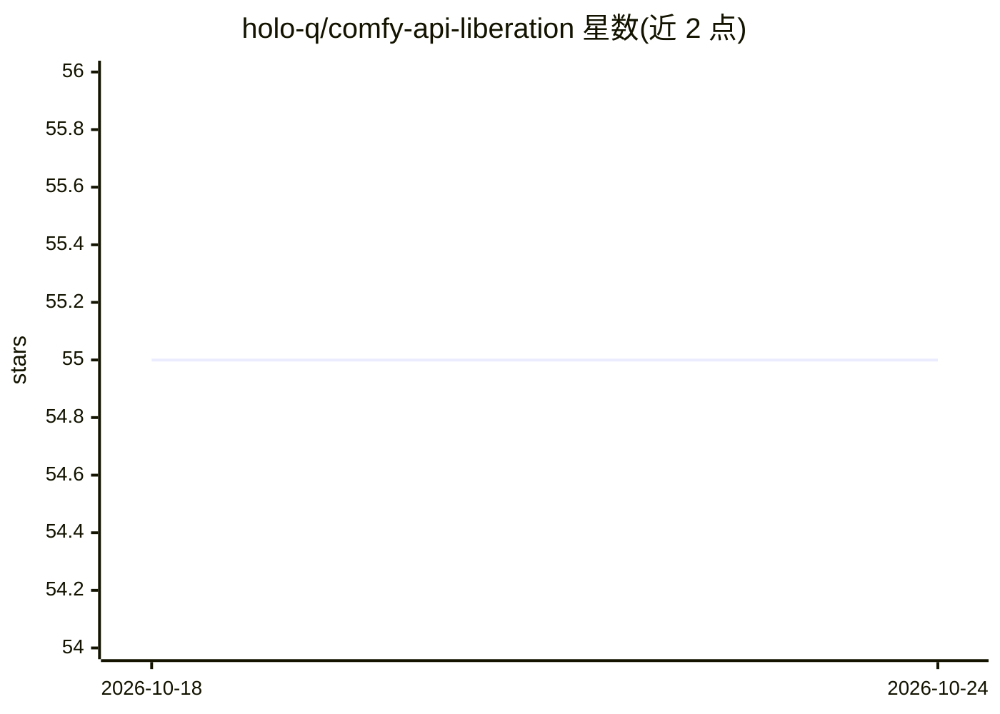

# holo-q/comfy-api-liberation

⭐ 55 · Python · MIT · 推送 2026-04-05 · [GitHub](https://github.com/holo-q/comfy-api-liberation) · 个人维护

**ComfyUI 扩展：绕过 comfy.org 代理，用自己的 API key 直连厂商**

一个 ComfyUI 自定义节点扩展，拦截 ComfyUI 内置 API 节点发往 api.comfy.org 代理的请求，改写为直连各厂商 API 端点并注入用户自有的 API key，资产文件保留在本机。支持 30+ 提供商（Google、OpenAI、Stability、BFL、Runway、腾讯混元 3D 等），密钥可通过 UI、pass 密码管理器或 api_keys.json 配置；未配置 key 时回退到 ComfyUI 默认行为。以 git clone 到 custom_nodes 目录方式安装。

## 筛选速览

| 维度 | 判定 | 备注 |
|---|---|---|
| AI 角色 | `ai-ecosystem` | LLM/agent 周边工具 |
| 许可风险 | `permissive` | MIT |
| 部署形态 | `None` |  |
| 模型依赖 | — | README 未给出锁定关系 |
| 硬件要求 | — | 无带数字的原话,不猜 |
| 安装摩擦 | `low` | 无编译、无系统依赖或容器化 |
| 成熟度 | — | 结构信号不足 |

## 能力要点

- 拦截并改写 /proxy/* 请求为直连厂商 API，无需改现有工作流
- 支持 30+ 提供商：文本、图像、视频、3D、SVG、音频类 API
- 三种密钥配置方式：UI、pass 密码管理器路径、api_keys.json
- 资产本地存储，key 不发送到 Comfy.org 服务器

## 适用场景

- 在 ComfyUI 中使用自己的厂商 API key 直连调用
- 避免通过代理购买不透明积分、减少第三方经手数据
- 管理多厂商 key 并检查未覆盖的代理端点

## 场景标签

`图像生成` `模型网关` · 领域:Agent 开发

## 证据(README 行号)

> L12: This extension removes the middleman entirely. Your calls go direct. Your keys, your rates, your data.
> L178: 1. **Intercepts** outgoing API requests before they leave ComfyUI

## 星数曲线

2026-10-18 55 → 2026-10-24 55（+0）

---
*卡片 v1 · prompt 1.4 · 生成 2026-10-24 · 置信度 high · 依据 README sha `df8f9aa3c2f7` · [字段定义](../../DATASET.md)*
