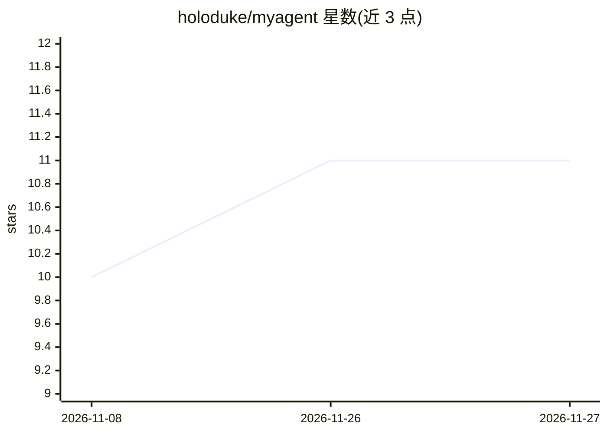

# holoduke/myagent

⭐ 11 · TypeScript · 推送 2026-09-20 · [GitHub](https://github.com/holoduke/myagent) · 个人维护

**个人自主 AI 代理：24/7 观察消息邮件日历并自主行动**

部署在个人基础设施上的常驻自主代理，观察 WhatsApp、Gmail、Google Calendar、Home Assistant、RSS 与位置数据，构建多层联想记忆图（活跃/归档/幽灵三层存储，含 WAL 日志），按 tick 循环（观察/思考/整合/反思）自主运行并可主动发起消息。基于 TypeScript 后端、Claude Code CLI 与 Nuxt 仪表盘构建。需 Claude Max 订阅，README 附有自主运行与自改代码的风险警告。

## 筛选速览

| 维度 | 判定 | 备注 |
|---|---|---|
| AI 角色 | `ai-native` | 本体是模型或模型工具 |
| 许可风险 | `none` | — |
| 部署形态 | `self-host` | docker 或自建部署 |
| 模型依赖 | locked-api |  |
| 硬件要求 | — | 无带数字的原话,不猜 |
| 安装摩擦 | `low` | 无编译、无系统依赖或容器化 |
| 成熟度 | — | 结构信号不足 |

## 能力要点

- 三层记忆图存储（活跃/归档 2000/幽灵图 5000）加 WAL 追加日志
- 基于 Ebbinghaus 遗忘曲线的五级保留分层与间隔重复
- 12 步整合流水线与多个研究启发的认知模块（知识编译、情绪追踪、因果链等）
- 通过安全管道修改自身源码的自改进机制

## 适用场景

- 让代理持续观察个人消息与日程并主动提供洞察
- 管理 Home Assistant 设备的个人助理场景
- 构建带长期记忆的 24/7 个人代理实验

## 场景标签

`AI 助手` `Agent 记忆` · 领域:Agent 开发

## 证据(README 行号)

> L3: A self-improving autonomous AI that runs 24/7 on your own infrastructure. ARIA observes your WhatsApp messages, Gmai
> L131: |**Observe**|60s|Buffer new messages, reinforce person nodes. No LLM call.|
> L132: |**Think**|~5 min active / 30 min idle|Spreading activation selects relevant memories. LLM processes observations,

## 星数曲线

2026-11-08 10 → 2026-11-27 11（+1）

---
*卡片 v1 · prompt 1.4 · 生成 2026-11-19 · 置信度 high · 依据 README sha `315e266af1b0` · [字段定义](../../DATASET.md)*
