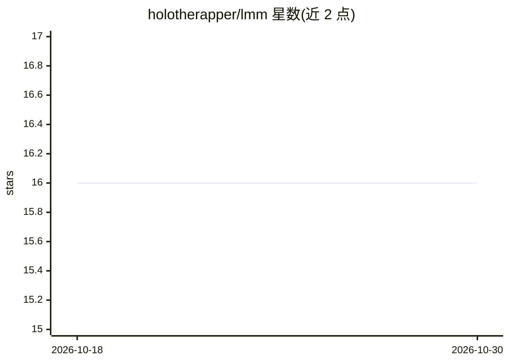

# holotherapper/lmm

⭐ 16 · Rust · Apache-2.0 · 推送 2026-05-21 · [GitHub](https://github.com/holotherapper/lmm) · 个人维护

**macOS/Linux 本地 AI 模型统一管理 CLI：HF Cache 单一存储**

Rust 编写的命令行本地模型管理器，面向 macOS 与 Linux 用户：以 Hugging Face Cache 作为唯一规范存储，通过符号链接把模型暴露给各本地 AI 工具（LM Studio、llama.cpp、Jan、ComfyUI 等 9 个适配器），避免同一模型被不同工具重复下载。支持 MLX/GGUF/safetensors 格式、终端内交互搜索与安装、adopt 已有缓存模型、doctor 校验与 gc 清理。Ollama 因采用复制式 blob 存储仅作展示管理。经 Homebrew 或 cargo 源码安装。

## 筛选速览

| 维度 | 判定 | 备注 |
|---|---|---|
| AI 角色 | `ai-ecosystem` | LLM/agent 周边工具 |
| 许可风险 | `permissive` | Apache-2.0 |
| 部署形态 | `library` | 以包/库形式分发 |
| 模型依赖 | local-ok | 支持本地模型 |
| 硬件要求 | — | 无带数字的原话,不猜 |
| 安装摩擦 | `low` | 无编译、无系统依赖或容器化 |
| 成熟度 | — | 结构信号不足 |

## 能力要点

- HF Cache 单一存储 + 符号链接暴露，避免跨工具重复下载
- 9 个工具适配器（LM Studio、llama.cpp、ComfyUI 等，部分实验性）
- MLX / GGUF / safetensors 格式支持与 Hugging Face 交互式搜索安装
- doctor 校验、gc 清理与 adopt 纳管已有缓存模型

## 适用场景

- 多个本地 AI 工具共用同一批模型文件，节省磁盘
- 从终端直接搜索并安装 Hugging Face 模型
- 清理和校验散落各处的本地模型缓存

## 场景标签

 · 领域:本地 AI 模型管理/开发者工具

## 证据(README 行号)

> L8: Local AI model manager for macOS and Linux.
> L18: `lmm` uses HF Cache as the single canonical store and exposes models to each tool via symlinks — **zero duplication
> L24: - **Tool adapters** — LM Studio, llama.cpp, Jan, ComfyUI, text-generation-webui, and more

## 星数曲线

2026-10-18 16 → 2026-10-30 16（+0）

---
*卡片 v1 · prompt 1.4 · 生成 2026-10-30 · 置信度 high · 依据 README sha `646bda62b6e8` · [字段定义](../../DATASET.md)*
