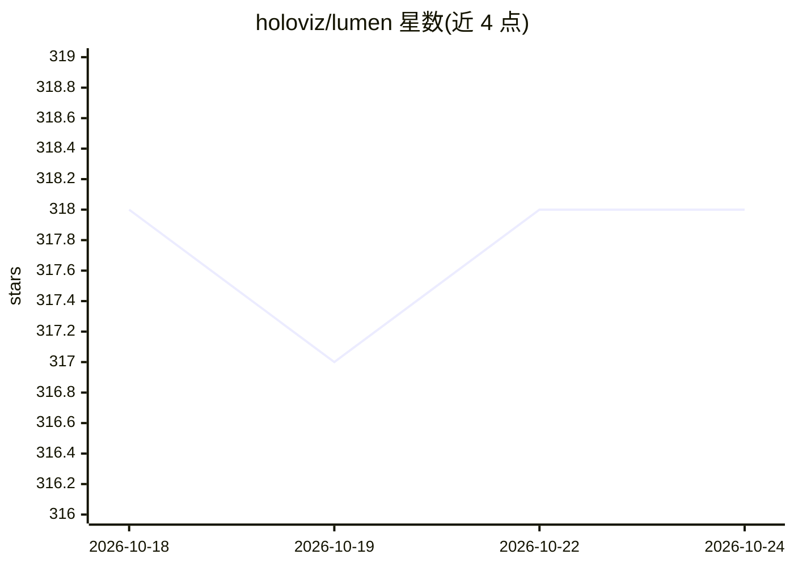

# holoviz/lumen

⭐ 318 · Python · BSD-3-Clause · 推送 2026-10-24 · [GitHub](https://github.com/holoviz/lumen) · [官网](https://lumen.holoviz.org) · 组织维护

**开源 Agent 框架：自然语言生成 SQL、图表与仪表盘**

Holoviz 维护的开源 agent 框架，面向用自然语言与数据对话的场景：基于声明式数据模型让 LLM 生成 SQL/Python 数据转换管线、图表、数据表与整个仪表盘，支持本地或远程文件、SQL 数据库与数据湖；可接入文档提供上下文与嵌入实现 RAG；生成的管线与可视化可序列化，供分享、在 notebook 中继续分析或经拖拽组装成仪表盘。所有 LLM 输出可检查、校验与手工编辑。构建于 Panel 之上，提供 conda 与 pip 安装，运行 lumen-ai serve 启动 Explorer 服务。可通过自定义 agent、工具与分析扩展。

## 筛选速览

| 维度 | 判定 | 备注 |
|---|---|---|
| AI 角色 | `ai-ecosystem` | LLM/agent 周边工具 |
| 许可风险 | `permissive` | BSD-3-Clause |
| 部署形态 | `library` | 以包/库形式分发 |
| 模型依赖 | — | README 未给出锁定关系 |
| 硬件要求 | — | 无带数字的原话,不猜 |
| 安装摩擦 | `low` | 无编译、无系统依赖或容器化 |
| 成熟度 | — | 结构信号不足 |

## 能力要点

- 自然语言生成 SQL 数据管线，支持文件、SQL 数据库与数据湖
- 生成图表、数据表与完整仪表盘，输出可序列化与分享
- 文档上下文与嵌入支持的 RAG 能力
- LLM 输出可检查、校验并手工编辑；支持自定义 agent、工具与分析

## 适用场景

- 用自然语言探索数据并生成可视化与仪表盘
- 为非编程人员提供免代码的数据分析途径
- 将生成的分析管线导出到 notebook 继续处理

## 场景标签

`数据分析` · 领域:效率与自动化

## 证据(README 行号)

> L16: Lumen is a fully open-source and extensible agent based framework for chatting with data and for retrieval augmente
> L25: Lumen sets itself apart from other agent based frameworks in that it focuses on being fully open and extensible. Wi

## 星数曲线

2026-10-18 318 → 2026-10-24 318（+0）

---
*卡片 v1 · prompt 1.4 · 生成 2026-10-21 · 置信度 high · 依据 README sha `e043d83d247b` · [字段定义](../../DATASET.md)*
