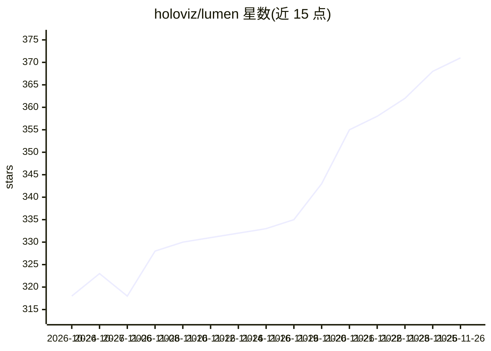

# holoviz/lumen

⭐ 371 · Python · BSD-3-Clause · 推送 2026-11-25 · [GitHub](https://github.com/holoviz/lumen) · [官网](https://lumen.holoviz.org/) · 组织维护

**用自然语言对话探索数据、生成 SQL 与仪表盘的 agent 框架**

开源、可扩展的 agent 框架，用于与数据对话及 RAG。基于声明式数据模型，LLM 可生成完整的数据转换管线、可视化与仪表盘，产物可序列化以共享或在 notebook 中继续分析。支持对接本地/远程文件、SQL 数据库与数据湖，可接入自有文档作为上下文；所有 LLM 输出可检查、修正与手动编辑，并可通过自定义 agent、工具和分析扩展。需 Python 3.11+，基于 Panel 渲染。

## 筛选速览

| 维度 | 判定 | 备注 |
|---|---|---|
| AI 角色 | `ai-native` | 本体是模型或模型工具 |
| 许可风险 | `permissive` | BSD-3-Clause |
| 部署形态 | `library` | 以包/库形式分发 |
| 模型依赖 | — | README 未给出锁定关系 |
| 硬件要求 | — | 无带数字的原话,不猜 |
| 安装摩擦 | `low` | 无编译、无系统依赖或容器化 |
| 成熟度 | — | 结构信号不足 |

## 能力要点

- 自然语言生成 SQL 数据管线、图表与整个仪表盘
- 声明式数据模型使产物可序列化、共享与复现
- 接入自有文档提供 RAG 上下文
- 支持自定义 agent、工具与领域分析扩展

## 适用场景

- 用对话方式探索 CSV 或数据库中的数据并生成图表
- 快速搭建由自然语言驱动的数据仪表盘
- 让非编程人员执行复杂的多步数据分析
- 结合自有文档做检索增强问答

## 场景标签

`Agent 框架` `数据分析` `RAG` · 领域:Agent 开发

## 证据(README 行号)

> L16: Lumen is a fully open-source and extensible agent based framework for chatting with data and for retrieval augmente
> L31: Lumen works with Python 3.11 and above on Linux, Windows, or Mac. The recommended way to install Lumen is using the

## 星数曲线

2026-10-24 318 → 2026-11-26 371（+53）

---
*卡片 v1 · prompt 1.4 · 生成 2026-11-25 · 置信度 high · 依据 README sha `2a66ed0093f6` · [字段定义](../../DATASET.md)*
