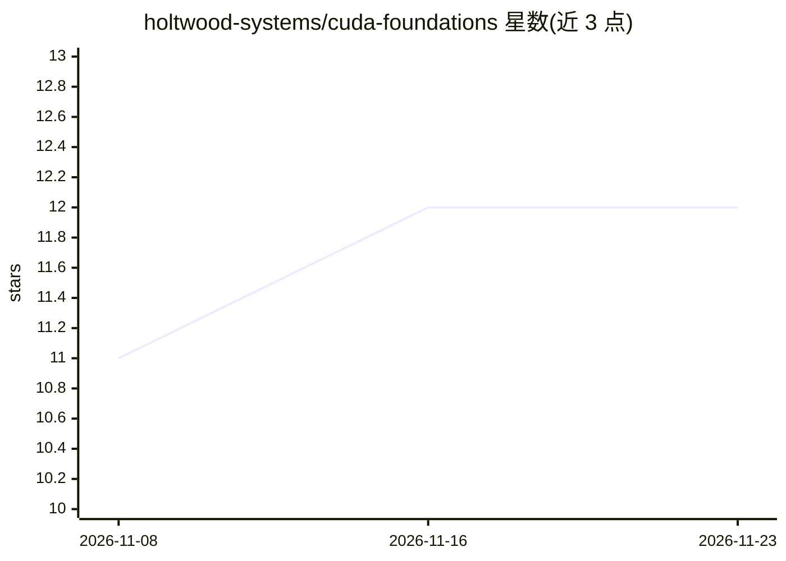

# holtwood-systems/cuda-foundations

⭐ 12 · C++ · MIT · 推送 2026-11-11 · [GitHub](https://github.com/holtwood-systems/cuda-foundations) · [官网](https://holtwood-systems.github.io/cuda-foundations/) · 组织维护 · 中文 README

**CUDA 算子工程学习仓库：SGEMM 优化阶梯到轻量推理组件**

教学仓库，含 4 个模块：01 模块在 SGEMM 上演示 5 步优化阶梯（naive→tiled→bank-conflict-free→double buffering→WMMA）；02 模块组织为 header-only 算子库（gemm/attention/softmax/warp reduction/memory pool）；03 模块覆盖进阶 CUDA/HPC 模式；04 模块展示 kernel、内存、流在小型推理系统中的组织方式。每步带 GoogleTest 不变量检查与 cuBLAS 参照基准，记录测试机 261/261 通过。提供 CMake 预设与独立 Makefile 两种构建路径，明确不做生产级推理运行时。

## 筛选速览

| 维度 | 判定 | 备注 |
|---|---|---|
| AI 角色 | `ai-knowledge` | 知识聚合/清单类 |
| 许可风险 | `permissive` | MIT |
| 部署形态 | `None` |  |
| 模型依赖 | — | README 未给出锁定关系 |
| 硬件要求 | — | 无带数字的原话,不猜 |
| 安装摩擦 | `high` | 编译与系统依赖俱全 |
| 成熟度 | — | 结构信号不足 |

## 能力要点

- SGEMM 的 5 步优化阶梯，每步为可独立构建验证的 kernel 文件
- 每步优化配 GoogleTest 不变量检查与 cuBLAS 参照基准
- 04 模块教学预览：kernel/内存池/流构成轻量推理流程
- root CMake 预设图 + 独立 Makefile 双构建路径

## 适用场景

- 从零理解 CUDA kernel 优化的每一步瓶颈与解法
- 参考 header-only 算子库的工程布局
- 面试前梳理 GEMM 优化的知识点对应关系

## 场景标签

`教程课程` · 领域:学习与行业

## 证据(README 行号)

> L19:  A repository for people who want to understand how CUDA kernels evolve from a first correct GEMM into reusable ker
> L40: Teaching repository, status **stable** (correctness fixes and teaching
> L69: - GEMM 优化阶梯（naive → tiled → bank-conflict-free → double buffering → WMMA）

## 星数曲线

2026-11-08 11 → 2026-11-23 12（+1）

---
*卡片 v1 · prompt 1.4 · 生成 2026-11-18 · 置信度 high · 依据 README sha `4800af546c75` · [字段定义](../../DATASET.md)*
