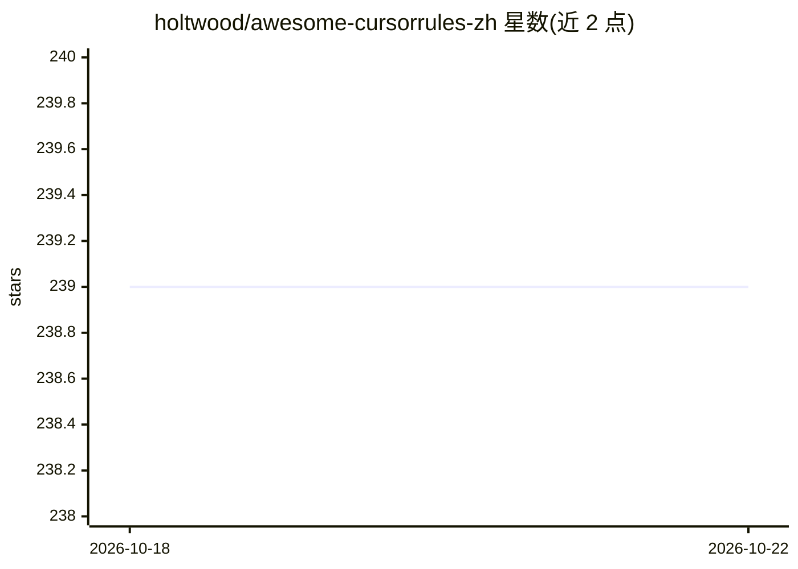

# holtwood/awesome-cursorrules-zh

⭐ 239 · JavaScript · MIT · 推送 2026-10-19 · [GitHub](https://github.com/holtwood/awesome-cursorrules-zh) · [官网](https://holtwood.github.io/awesome-cursorrules-zh/) · 个人维护 · 中文 README

**中文开发者的 Cursor AI 编程规则精选集（132 条）**

Awesome Cursor Rules 的中文本地化版本，收录 132 个 .cursorrules 规则文件，按前端、后端、移动端、AI、DevOps、区块链等 32 个技术领域组织，附 190 个技术文档与中英双语对照。用户通过 git clone 获取仓库后，将对应技术栈的 .cursorrules 文件复制到项目根目录，Cursor 编辑器中的 AI 助手即按该规则生成代码。提供合并规则、目录级规则等使用方式与在线文档站点，基于 MIT 许可，由个人维护并跟踪与上游 PatrickJS/awesome-cursorrules 的同步。

## 筛选速览

| 维度 | 判定 | 备注 |
|---|---|---|
| AI 角色 | `ai-knowledge` | 知识聚合/清单类 |
| 许可风险 | `permissive` | MIT |
| 部署形态 | `None` |  |
| 模型依赖 | — | README 未给出锁定关系 |
| 硬件要求 | — | 无带数字的原话,不猜 |
| 安装摩擦 | `low` | 无编译、无系统依赖或容器化 |
| 成熟度 | — | 结构信号不足 |

## 能力要点

- 132 个 .cursorrules 规则文件，覆盖 32 个技术领域
- 100% 中英双语翻译，190 个技术文档
- 支持单技术栈复制、多技术栈合并与目录级规则三种用法

## 适用场景

- 为我的 React/TypeScript 项目配置 Cursor AI 编码规范
- 在单体仓库中为前后端目录分别放置不同规则
- 按技术栈查找现成的 Cursor 规则并自定义追加

## 场景标签

`精选清单` `提示工程` · 领域:Agent 开发

## 证据(README 行号)

> L13: 为中文开发者打造的 Cursor AI 编程规则集合
> L26: Awesome Cursor Rules 是优秀的 Cursor AI 编程助手规则集合。本项目是其**中文本地化版本**，专为中文开发者优化：

## 星数曲线

2026-10-18 239 → 2026-10-22 239（+0）

---
*卡片 v1 · prompt 1.4 · 生成 2026-10-22 · 置信度 high · 依据 README sha `e93b24a3a668` · [字段定义](../../DATASET.md)*
