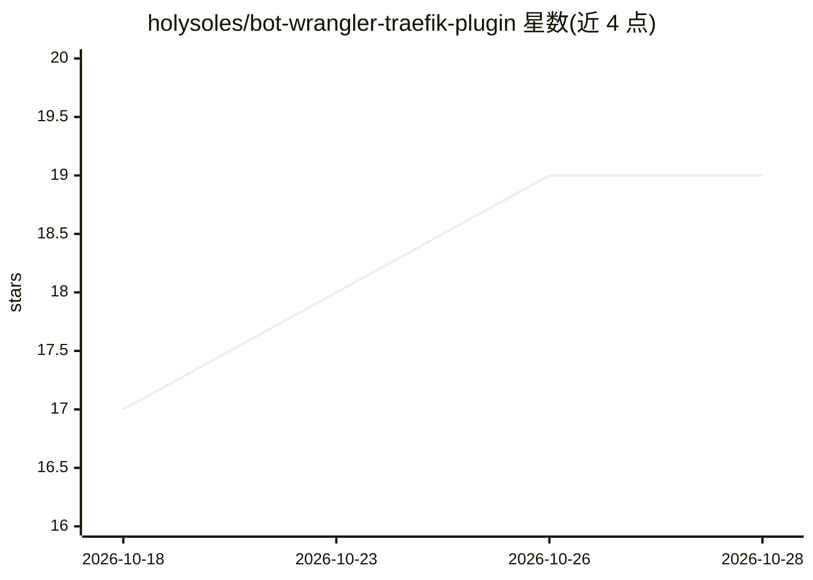

# holysoles/bot-wrangler-traefik-plugin

⭐ 20 · Go · Apache-2.0 · 推送 2026-09-02 · [GitHub](https://github.com/holysoles/bot-wrangler-traefik-plugin) · 个人维护

**管理 LLM 爬虫流量的 Traefik 中间件插件：统一 robots.txt 并处置恶意 bot**

部署在 Traefik 反向代理中的 Go 中间件插件：从 ai-robots-txt 等来源动态获取 LLM 爬虫 User-Agent 列表，自动生成并统一提供 robots.txt；对无视 robots.txt 的匹配请求执行可配置动作（PASS/LOG/BLOCK 403/PROXY 转发至 tarpit 服务如 Nepenthes、iocaine）。使用 Aho-Corasick 自动机与缓存做快速匹配，缓存默认 24 小时刷新。面向自建 Traefik 或 Kubernetes（Helm）部署的开发者/运维人员。

## 筛选速览

| 维度 | 判定 | 备注 |
|---|---|---|
| AI 角色 | `ai-ecosystem` | LLM/agent 周边工具 |
| 许可风险 | `permissive` | Apache-2.0 |
| 部署形态 | `library` | 以包/库形式分发 |
| 模型依赖 | — | README 未给出锁定关系 |
| 硬件要求 | — | 无带数字的原话,不猜 |
| 安装摩擦 | `low` | 无编译、无系统依赖或容器化 |
| 成熟度 | — | 结构信号不足 |

## 能力要点

- 从 ai-robots-txt 动态获取 LLM bot 名单，支持自定义来源（JSON/robots.txt/纯文本）
- 四种处置动作：PASS/LOG/BLOCK（可配状态码与响应体）/PROXY（转发至 tarpit）
- Aho-Corasick 快速 User-Agent 匹配与缓存（默认 500 条，24h 刷新）
- 统一生成 robots.txt，无需逐应用维护，支持 X-Robots-Tag noarchive 响应头

## 适用场景

- 在反向代理层统一拦截抓取内容的 LLM 爬虫
- 把违规爬虫流量转发到 tarpit 类服务消耗其资源
- 记录 bot 流量用于分析，多个应用共享一份 robots.txt

## 场景标签

`网络安全` · 领域:学习与行业

## 证据(README 行号)

> L8: Bot Wrangler is a Traefik plugin designed to improve your web application's security and performance by managing bot
> L10: By default, Bot user agents are retrieved from ai-robots-txt. Any queries to a service where this middleware is imp

## 星数曲线

2026-10-18 17 → 2026-10-28 19（+2）

---
*卡片 v1 · prompt 1.4 · 生成 2026-10-28 · 置信度 high · 依据 README sha `85aae7f30ba9` · [字段定义](../../DATASET.md)*
