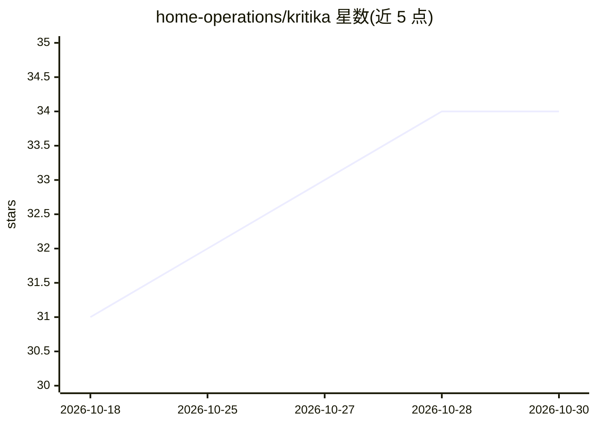

# home-operations/kritika

⭐ 34 · Go · AGPL-3.0 · 推送 2026-10-28 · [GitHub](https://github.com/home-operations/kritika) · [官网](https://kritika.home-operations.com/) · 组织维护

**面向 GitHub/Forgejo/GitLab/Gitea 的仓库感知 AI 代码评审机器人**

kritika 是自托管在 Kubernetes 上的 AI 评审服务：对 GitHub、Forgejo、GitLab、Gitea 的拉取请求发起评审，读取变更周边代码与仓库评审规则，发布摘要、行内发现与建议修复，push 后更新评审，并支持在评论中 @ 机器人提问或请求重审。提供 Web 仪表盘查看评审、用量与成本，可选置信度分数与自动批准，并向编码 agent 开放只读 MCP 端点。运行需 Kubernetes+Helm、带 VectorChord 的 Postgres 及 forge 侧账号与模型凭证；项目处于活跃开发期，配置与 API 可能在版本间变化。

## 筛选速览

| 维度 | 判定 | 备注 |
|---|---|---|
| AI 角色 | `ai-native` | 本体是模型或模型工具 |
| 许可风险 | `viral` | AGPL-3.0 |
| 部署形态 | `None` |  |
| 模型依赖 | — | README 未给出锁定关系 |
| 硬件要求 | — | 无带数字的原话,不猜 |
| 安装摩擦 | `low` | 无编译、无系统依赖或容器化 |
| 成熟度 | `idea` | |

## 能力要点

- 评审 PR 并在 push 后更新评审，输出摘要、行内发现与建议修复
- 读取仓库上下文与自定义评审规则，无需仓库配置文件
- Web 仪表盘展示评审、用量与成本
- 供编码 agent 读取评审与发现的只读 MCP 端点

## 适用场景

- 在我的开源仓库上自动评审 PR 并给出建议修复
- 在 PR 评论里向机器人追问某条发现的细节
- 自托管代码评审服务并统一查看团队评审成本

## 场景标签

`代码审查` · 领域:编码与开发

## 证据(README 行号)

> L9: kritika reviews pull requests on GitHub, Forgejo, GitLab and Gitea using the code around the change. It posts
> L21: - Reviews new pull requests and updates its review after a push.

## 星数曲线

2026-10-18 31 → 2026-10-30 34（+3）

---
*卡片 v1 · prompt 1.4 · 生成 2026-10-26 · 置信度 high · 依据 README sha `71f62e63b927` · [字段定义](../../DATASET.md)*
