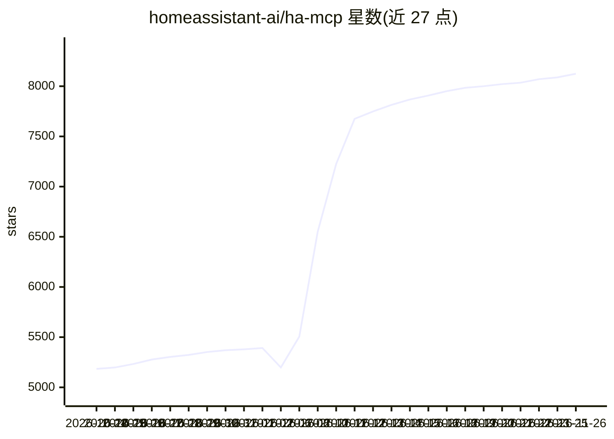

# homeassistant-ai/ha-mcp

⭐ 8,124 · Python · MIT · 推送 2026-11-25 · [GitHub](https://github.com/homeassistant-ai/ha-mcp) · [官网](https://homeassistant-ai.github.io/ha-mcp/) · 组织维护

**让 Claude/ChatGPT 等 AI 助手通过 MCP 配置与自动化 Home Assistant**

提供 87 个工具的 MCP 服务器，将 Home Assistant 暴露给 MCP 客户端，使其能读取和控制家庭自动化实例。推荐方式是通过 Home Assistant 内置 Marketplace 安装 in-process 集成，适用于 OS/Supervised/Container/Core 全部安装类型；另有 add-on、Docker、PyPI/uvx、本地 stdio 等安装路径。远程访问经 Nabu Casa、Webhook Proxy 或 OpenAI Tunnel；stdio 传输存在已知连接问题，仅建议用于演示测试。需要管理员长期访问令牌或专用账号。

## 筛选速览

| 维度 | 判定 | 备注 |
|---|---|---|
| AI 角色 | `ai-ecosystem` | LLM/agent 周边工具 |
| 许可风险 | `permissive` | MIT |
| 部署形态 | `library` | 以包/库形式分发 |
| 模型依赖 | — | README 未给出锁定关系 |
| 硬件要求 | — | 无带数字的原话,不猜 |
| 安装摩擦 | `low` | 无编译、无系统依赖或容器化 |
| 成熟度 | — | 结构信号不足 |

## 能力要点

- 提供 87 个 MCP 工具管理 Home Assistant
- 支持集成、add-on、Docker、PyPI/uvx、stdio 多种安装方式
- 远程访问支持 Nabu Casa、Webhook Proxy、OpenAI Tunnel 与 OIDC 认证
- 自带侧边栏设置面板管理工具、功能开关与备份

## 适用场景

- 用 Claude 或 ChatGPT 对话式配置和自动化 Home Assistant
- 在 Container/Core 安装上通过 Docker/PyPI 独立运行 MCP 服务器
- 通过演示环境先试用再接入自己的 Home Assistant

## 场景标签

 · 领域:智能家居/自动化

## 证据(README 行号)

> L5:  # HA-MCP — Manage Home Assistant with AI
> L18:  Configure and automate Home Assistant with Claude, ChatGPT, and other AI assistants.
> L24: The recommended way to run ha-mcp is the **HA-MCP integration**. It installs into Home Assistant through the built-

## 星数曲线

2026-10-24 5,184 → 2026-11-26 8,124（+2,940）

---
*卡片 v1 · prompt 1.4 · 生成 2026-11-24 · 置信度 high · 依据 README sha `b7f29c8ba8f5` · [字段定义](../../DATASET.md)*
