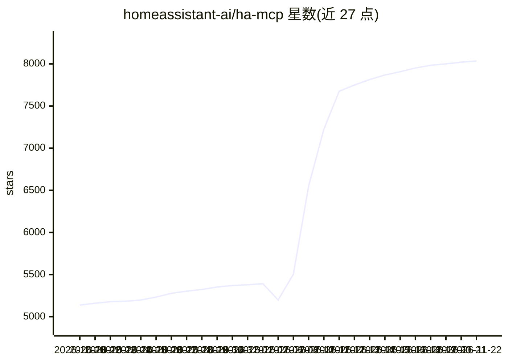

# homeassistant-ai/ha-mcp

⭐ 8,035 · Python · MIT · 推送 2026-11-21 · [GitHub](https://github.com/homeassistant-ai/ha-mcp) · [官网](https://homeassistant-ai.github.io/ha-mcp/) · 组织维护

**让 Claude/ChatGPT 等 AI 助手配置与自动化 Home Assistant 的 MCP 服务器**

面向 Home Assistant 用户的 MCP 服务器，提供 86 个工具供 AI 客户端读取与控制家庭自动化实例。安装方式以内置 Marketplace 的 in-process 集成为首选，兼容 HA OS/Supervised/Container/Core 四种安装类型；另有 add-on（app）、Docker、PyPI/uvx 与本地 stdio 等途径，各客户端应仅配置其一。支持通过 Nabu Casa、Webhook Proxy 或 OpenAI Tunnel 实现远程接入，内置管理面板、可选 HA 账号认证与 OIDC。仅支持当前稳定版 Home Assistant（下限 2026.11.0）。

## 筛选速览

| 维度 | 判定 | 备注 |
|---|---|---|
| AI 角色 | `ai-ecosystem` | LLM/agent 周边工具 |
| 许可风险 | `permissive` | MIT |
| 部署形态 | `library` | 以包/库形式分发 |
| 模型依赖 | local-ok | 支持本地模型 |
| 硬件要求 | — | 无带数字的原话,不猜 |
| 安装摩擦 | `low` | 无编译、无系统依赖或容器化 |
| 成熟度 | — | 结构信号不足 |

## 能力要点

- 86 个工具覆盖 Home Assistant 配置与自动化操作
- in-process 集成通过内置 Marketplace 安装，无需自定义仓库
- 多种部署途径：集成、add-on、Docker、PyPI/uvx、本地 stdio
- Setup Wizard 生成 15+ 客户端的连接配置

## 适用场景

- 用对话方式配置和自动化我的 Home Assistant 设备
- 在没有公网地址的环境下让 ChatGPT 连接家中实例
- 先连演示服务器试用，再切换到自己的 Home Assistant

## 场景标签

 · 领域:智能家居/AI 基础设施

## 证据(README 行号)

> L5:  # HA-MCP — Manage Home Assistant with AI
> L18:  Configure and automate Home Assistant with Claude, ChatGPT, and other AI assistants.
> L24: The recommended way to run ha-mcp is the **HA-MCP integration**. It installs into Home Assistant through the built-

## 星数曲线

2026-10-20 5,138 → 2026-11-22 8,035（+2,897）

---
*卡片 v1 · prompt 1.4 · 生成 2026-11-22 · 置信度 high · 依据 README sha `f05a1c47f64a` · [字段定义](../../DATASET.md)*
