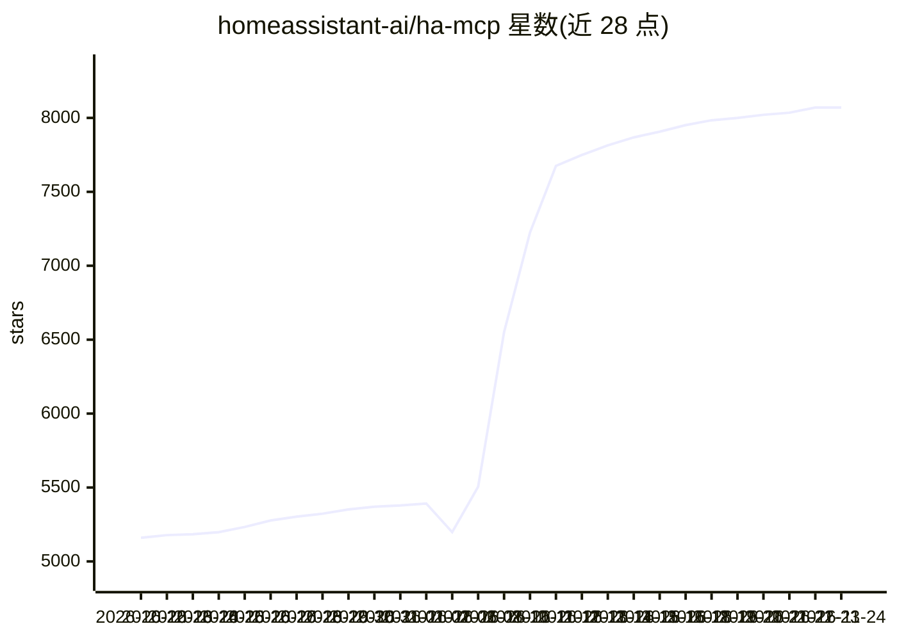

# homeassistant-ai/ha-mcp

⭐ 8,070 · Python · MIT · 推送 2026-11-22 · [GitHub](https://github.com/homeassistant-ai/ha-mcp) · [官网](https://homeassistant-ai.github.io/ha-mcp/) · 组织维护

**让 AI 助手配置和自动化 Home Assistant 的 MCP 服务器**

提供 87 个工具的 MCP 服务器，使 Claude、ChatGPT 等 AI 客户端能够配置和自动化 Home Assistant。推荐方式是通过 Home Assistant 内置 Marketplace 安装集成，以 in-process 方式运行完整服务器，支持 OS/Supervised/Container/Core 各类安装；另有 add-on、Docker、PyPI/uvx、本地 stdio 等安装方式，每种客户端只应配置一种。提供 Setup Wizard 为 15+ 客户端生成配置，支持 secret URL 或 Home Assistant 账号认证，可通过 Nabu Casa、Webhook Proxy 或 OpenAI Tunnel 实现远程访问，并附带连接托管 demo 环境的一键脚本。

## 筛选速览

| 维度 | 判定 | 备注 |
|---|---|---|
| AI 角色 | `ai-ecosystem` | LLM/agent 周边工具 |
| 许可风险 | `permissive` | MIT |
| 部署形态 | `library` | 以包/库形式分发 |
| 模型依赖 | — | README 未给出锁定关系 |
| 硬件要求 | — | 无带数字的原话,不猜 |
| 安装摩擦 | `low` | 无编译、无系统依赖或容器化 |
| 成熟度 | — | 结构信号不足 |

## 能力要点

- 87 个工具覆盖 Home Assistant 配置与自动化
- 推荐经内置 Marketplace 安装集成，in-process 运行于任意 HA 安装类型
- 支持 Docker、PyPI/uvx、add-on、stdio 多种运行方式
- Setup Wizard 为 Claude Code、Gemini CLI、ChatGPT 等 15+ 客户端生成配置

## 适用场景

- 用自然语言让 AI 客户端管理和自动化家庭设备
- 为本地或远程的 AI 客户端接入 Home Assistant
- 无需自己的 HA 实例先试用 demo 环境体验 AI 控制

## 场景标签

 · 领域:智能家居/自动化

## 证据(README 行号)

> L5:  # HA-MCP — Manage Home Assistant with AI
> L18:  Configure and automate Home Assistant with Claude, ChatGPT, and other AI assistants.
> L24: The recommended way to run ha-mcp is the **HA-MCP integration**. It installs into Home Assistant through the built-

## 星数曲线

2026-10-22 5,160 → 2026-11-24 8,070（+2,910）

---
*卡片 v1 · prompt 1.4 · 生成 2026-11-23 · 置信度 high · 依据 README sha `3bdc95d9d4e6` · [字段定义](../../DATASET.md)*
