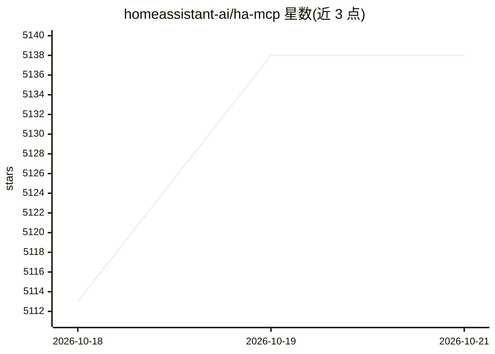

# homeassistant-ai/ha-mcp

⭐ 5,138 · Python · MIT · 推送 2026-10-19 · [GitHub](https://github.com/homeassistant-ai/ha-mcp) · [官网](https://homeassistant-ai.github.io/ha-mcp/) · 组织维护

**让 AI 助手通过 MCP 自然语言控制 Home Assistant 的服务器**

基于 FastMCP 构建的 Model Context Protocol 服务器（非官方），提供 87 个工具，使 Claude、ChatGPT 等 MCP 客户端能用自然语言控制智能家居设备、查询状态、执行服务、管理与调试自动化及编辑 Lovelace 仪表盘。推荐通过 HACS 安装 HA-MCP Custom Component 在 Home Assistant 内进程运行，兼容 OS/Supervised/Container/Core 全部安装类型；另提供 Home Assistant 应用（add-on）、Docker、PyPI/uvx HTTP 与本地 stdio 等独立运行方式，远程访问可走 Nabu Casa webhook、反向代理或 OIDC。stdio 传输存在已知连接问题，仅建议演示测试用。

## 筛选速览

| 维度 | 判定 | 备注 |
|---|---|---|
| AI 角色 | `ai-ecosystem` | LLM/agent 周边工具 |
| 许可风险 | `permissive` | MIT |
| 部署形态 | `library` | 以包/库形式分发 |
| 模型依赖 | — | README 未给出锁定关系 |
| 硬件要求 | — | 无带数字的原话,不猜 |
| 安装摩擦 | `low` | 无编译、无系统依赖或容器化 |
| 成熟度 | — | 结构信号不足 |

## 能力要点

- 87 个 MCP 工具，控制设备、查询状态、执行服务、管理自动化
- HACS 自定义组件在 Home Assistant 内进程运行，全安装类型兼容
- 多种运行方式：add-on、Docker（ghcr.io 镜像）、PyPI/uvx、stdio
- 为 15+ 客户端（Claude Code、Gemini CLI、ChatGPT、Cursor 等）提供配置向导

## 适用场景

- 用自然语言让 AI 助手控制家里的智能设备
- 让 AI 创建、修改和调试 Home Assistant 自动化
- 通过对话更新 Lovelace 仪表盘卡片

## 场景标签

 · 领域:智能家居/AI 集成

## 证据(README 行号)

> L18:  A comprehensive Model Context Protocol (MCP) server that enables AI assistants to interact with Home Assistant.
> L25: The recommended way to run ha-mcp is the **HA-MCP Custom Component**. It installs into Home Assistant through HACS,
> L74: - **Docker (HTTP server):** run `ghcr.io/homeassistant-ai/ha-mcp` in HTTP mode, pointed at your Home Assistant URL 

## 星数曲线

2026-10-18 5,113 → 2026-10-21 5,138（+25）

---
*卡片 v1 · prompt 1.4 · 生成 2026-10-20 · 置信度 high · 依据 README sha `91e43f88d01f` · [字段定义](../../DATASET.md)*
