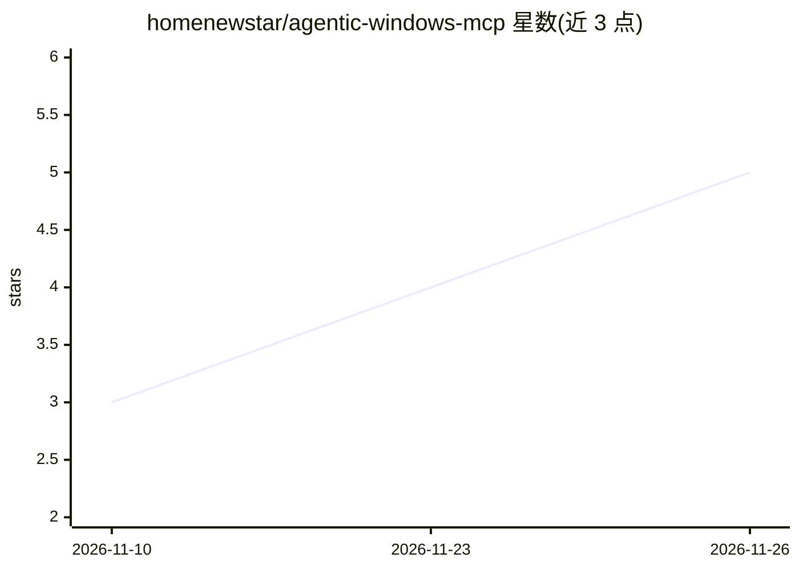

# homenewstar/agentic-windows-mcp

⭐ 5 · Python · Apache-2.0 · 推送 2026-11-17 · [GitHub](https://github.com/homenewstar/agentic-windows-mcp) · 个人维护

**让任意 AI agent 远程安全控制 Windows PC 的 MCP 服务器**

一个 Windows 平台的 MCP 服务器，通过 UI Automation 树提供桌面鼠标键盘控制、窗口与应用管理，通过 PowerShell/文件系统/注册表提供系统自动化，通过 CDP 连接已开启的 Chrome/Edge/Brave 提供浏览器 DevTools 级检查，并支持 agent 在本机完成编码全流程。安全机制包括可视控制指示器、接管热键、三档控制策略、Bearer/OAuth 认证与默认关闭遥测。通过 PyPI 安装，供个人或远程使用自家机器的开发者接入 Muse、ChatGPT、Claude、Gemini、DeepSeek 等 agent。

## 筛选速览

| 维度 | 判定 | 备注 |
|---|---|---|
| AI 角色 | `ai-ecosystem` | LLM/agent 周边工具 |
| 许可风险 | `permissive` | Apache-2.0 |
| 部署形态 | `desktop` | 安装包/桌面程序 |
| 模型依赖 | — | README 未给出锁定关系 |
| 硬件要求 | — | 无带数字的原话,不猜 |
| 安装摩擦 | `low` | 无编译、无系统依赖或容器化 |
| 成熟度 | — | 结构信号不足 |

## 能力要点

- UI Automation 树快照让 agent 无需视觉模型即可理解界面，元素引用带严格校验与类型化错误
- CDP 附加已运行浏览器，提供 DOM/CSS/网络/存储/源码的 DevTools 级检查
- Ctrl+Alt+Shift+Space 接管热键、三档控制策略与强制 API key/OAuth 认证
- 自带用量指标持久化与可选 JSONL 调用追踪

## 适用场景

- 在手机上通过 ChatGPT 让家中 PC 打开项目、改代码、跑测试并推送到 GitHub
- 让 agent 对已打开的浏览器做网络请求与页面元素调试
- 通过 agent 批量自动化 Windows 桌面操作与系统管理任务

## 场景标签

`GUI 自动化` `浏览器自动化` `编码 Agent` · 领域:效率与自动化

## 证据(README 行号)

> L51: Alone, an AI agent can only *talk*. Alone, your PC just *sits there*. **Agentic Windows MCP** is the bridge that tu
> L56: |**2. The AI Agent**|The "brain": Muse, ChatGPT, Claude, Gemini, DeepSeek… analyzes, decides, writes code, issues c
> L73: - **Unrestricted PowerShell**: run commands, install software, administer the system — including **background jobs*

## 星数曲线

2026-11-10 3 → 2026-11-26 5（+2）

---
*卡片 v1 · prompt 1.4 · 生成 2026-11-21 · 置信度 high · 依据 README sha `00483c495421` · [字段定义](../../DATASET.md)*
