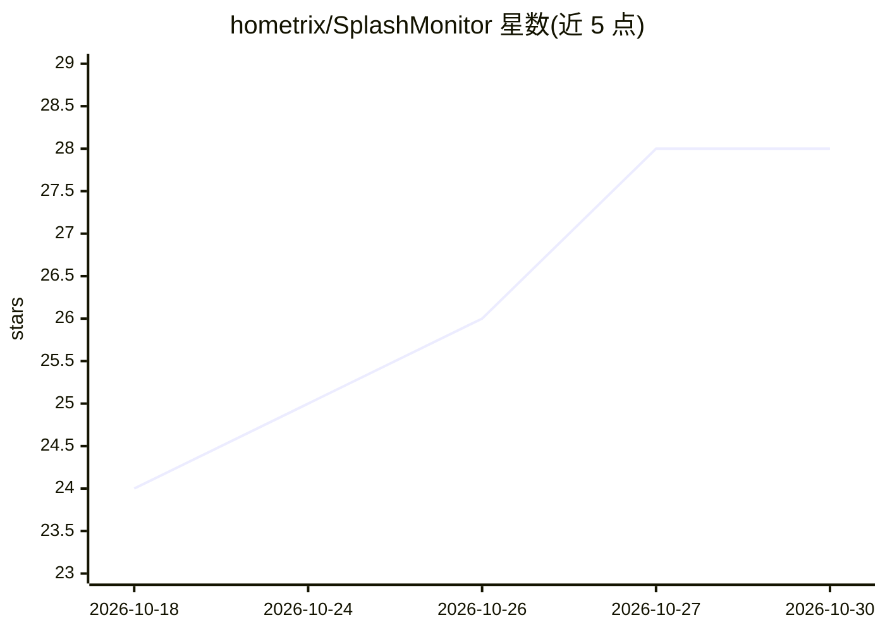

# hometrix/SplashMonitor

⭐ 28 · Swift · MIT · 推送 2026-10-27 · [GitHub](https://github.com/hometrix/SplashMonitor) · 个人维护

**面向 Apple Silicon 上 Splash 本地推理引擎的原生 macOS 监控与管理桌面应用**

SwiftUI 编写的 macOS 菜单栏/桌面应用，为 Inco AI 的 Splash 本地推理引擎提供图形化操作：实时指标仪表盘（prefill/decode 速度、KV Cache 命中、TTFT/ITL）、统一内存监控与压力告警、模型管理（本地目录、Hugging Face/NVIDIA 官方量化目录浏览与下载遥测）、服务器启停与热切换，以及 Claude Code、OpenCode、Codex 等编码 agent 启动器。要求先安装 Splash 引擎（brew tap）。提供 DMG、Homebrew Cask 与源码编译三种安装方式，双语（西/英）界面。

## 筛选速览

| 维度 | 判定 | 备注 |
|---|---|---|
| AI 角色 | `ai-ecosystem` | LLM/agent 周边工具 |
| 许可风险 | `permissive` | MIT |
| 部署形态 | `desktop` | 安装包/桌面程序 |
| 模型依赖 | local-ok | 支持本地模型 |
| 硬件要求 | — | 无带数字的原话,不猜 |
| 安装摩擦 | `low` | 无编译、无系统依赖或容器化 |
| 成熟度 | `idea` | |

## 能力要点

- 实时监控 prefill/decode tok/s、KV Cache 命中率、TTFT/ITL 与 Apple Neural Engine 状态
- 统一内存监控与系统内存压力哨兵，支持一键内存释放
- 模型管理：本地目录、Hugging Face 与 NVIDIA NVFP4/FP8 目录浏览、下载遥测、GGUF 变体支持
- 内置 Claude Code、Claude Cowork、OpenCode、Codex、Hermes、Pi、DeepSeek Harness 启动器

## 适用场景

- 在 Mac 菜单栏实时查看本地推理引擎的 tokens 速度与内存占用
- 图形化下载与管理 Hugging Face 上的 Splash 模型
- 一键启动本地推理服务器并拉起 Claude Code 等编码 agent

## 场景标签

`LLM 可观测性` · 领域:评测与运维

## 证据(README 行号)

> L29: Hasta ahora, Splash solo podía operarse desde la línea de comandos. **Splash Monitor** transforma esa experiencia e
> L125: Splash Monitor es un monitor gráfico para el motor de inferencia local **Splash** de Inco AI. Antes de instalar Sp

## 星数曲线

2026-10-18 24 → 2026-10-30 28（+4）

---
*卡片 v1 · prompt 1.4 · 生成 2026-10-26 · 置信度 high · 依据 README sha `d667344552d1` · [字段定义](../../DATASET.md)*
