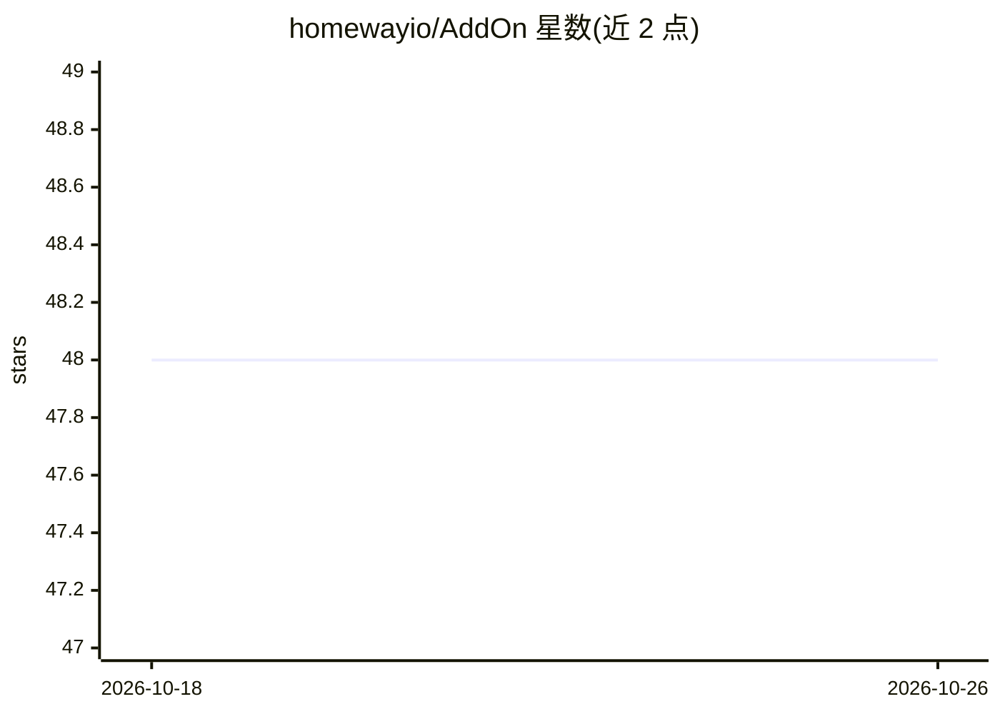

# homewayio/AddOn

⭐ 48 · Python · AGPL-3.0 · 推送 2026-10-22 · [GitHub](https://github.com/homewayio/AddOn) · [官网](https://homeway.io) · 组织维护

**面向 Home Assistant 的免费远程访问云服务，附 AI 语音助手与 MCP**

Home Assistant 社区云项目，提供远程访问、官方 iOS/Android 应用的移动连接、WebRTC 摄像头串流（含 STUN/TURN）、Alexa 与 Google Assistant 语音控制。AI 部分为 Sage 语音助手（ChatGPT/Claude/Gemini 驱动，56 种声音、个性定制）以及免费远程 MCP 服务器，允许任意 MCP 兼容 AI 客户端读取与控制家庭设备，可按工具粒度开关 AI 权限。以 Home Assistant 应用形式安装，另提供 CLI 与 Docker 独立安装方式。

## 筛选速览

| 维度 | 判定 | 备注 |
|---|---|---|
| AI 角色 | `ai-enhanced` | 去掉 AI 部分产品仍成立 |
| 许可风险 | `viral` | AGPL-3.0 |
| 部署形态 | `self-host` | docker 或自建部署 |
| 模型依赖 | — | README 未给出锁定关系 |
| 硬件要求 | — | 无带数字的原话,不猜 |
| 安装摩擦 | `low` | 无编译、无系统依赖或容器化 |
| 成熟度 | — | 结构信号不足 |

## 能力要点

- 免费远程访问与官方移动 App 连接
- WebRTC 摄像头串流，自动配置 STUN/TURN
- Sage AI 语音助手，支持 ChatGPT/Claude/Gemini 三种后端与 56 种声音
- 免费远程 MCP 服务器，可细粒度控制 AI 可访问的工具

## 适用场景

- 从外网安全访问家里的 Home Assistant 实例
- 让 AI 聊天助手通过 MCP 查看和控制家中设备
- 在手机 App 上远程查看摄像头实时画面

## 场景标签

`语音 Agent` · 领域:对话与助手

## 证据(README 行号)

> L6: Homeway is a Home Assistant community project aiming to provide free, private, and secure cloud tools for the entire
> L10: - 🚀 **Free.** Remotely access your Home Assistant from anywhere.
> L14: - ⭐ **AI Ready.** Free remote MCP server lets AI bots access and control your Home Assistant from anywhere.

## 星数曲线

2026-10-18 48 → 2026-10-26 48（+0）

---
*卡片 v1 · prompt 1.4 · 生成 2026-10-25 · 置信度 high · 依据 README sha `fc4a03976fe4` · [字段定义](../../DATASET.md)*
