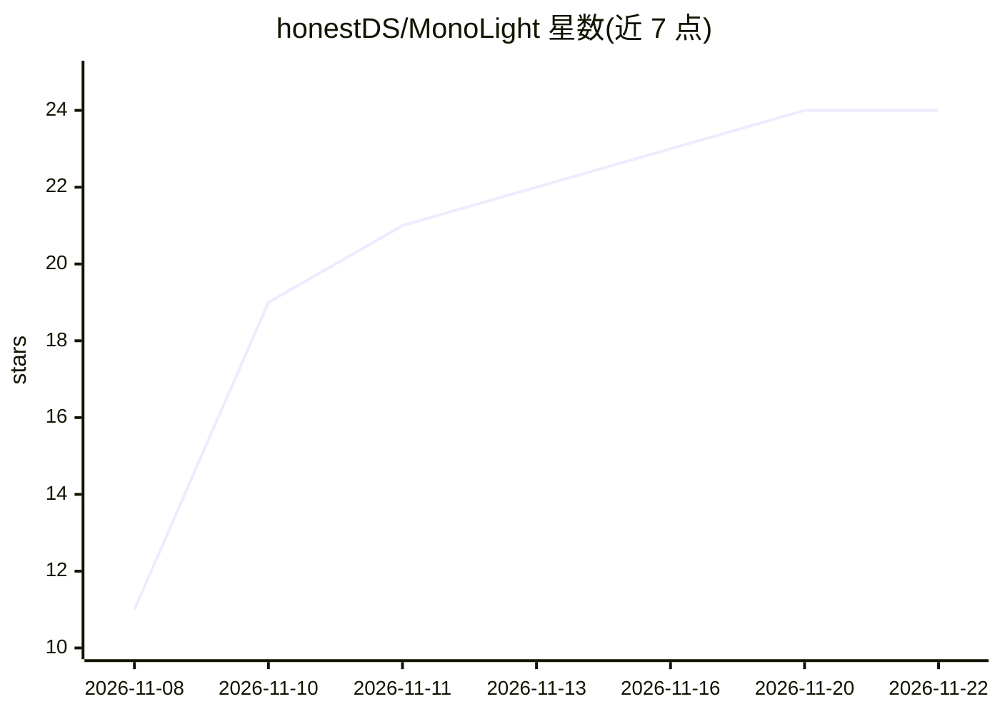

# honestDS/MonoLight

⭐ 24 · Python · MIT · 推送 2026-11-20 · [GitHub](https://github.com/honestDS/MonoLight) · 组织维护 · 中文 README

**自托管 AI 助手运行时：执行命令/编辑文件并带执行前安全审计**

可自部署的 AI 助手服务，支持运行命令、编辑/搜索本地文件、生成与回传图片、网页检索、并行子任务与定时任务。核心机制是把提出动作的模型与审计风险的模型分开：审计模型在指定工具调用执行前打分，命中确认规则的调用在 Web 面板或微信中等待人工批准。提供 Vue 面板、跨会话长期记忆、文档知识库（向量检索+重排），兼容 OpenAI/DeepSeek API 格式并可从 OpenRouter 拉取模型列表，各角色可配不同模型并按优先级/权重路由。通过 pip 安装依赖后 python start.py 启动，无内置沙箱，工具以服务账户权限运行；项目自述处于早期阶段、暂不接受 PR。

## 筛选速览

| 维度 | 判定 | 备注 |
|---|---|---|
| AI 角色 | `ai-native` | 本体是模型或模型工具 |
| 许可风险 | `permissive` | MIT |
| 部署形态 | `desktop` | 安装包/桌面程序 |
| 模型依赖 | — | README 未给出锁定关系 |
| 硬件要求 | — | 无带数字的原话,不猜 |
| 安装摩擦 | `low` | 无编译、无系统依赖或容器化 |
| 成熟度 | `idea` | |

## 能力要点

- 审计模型在工具执行前评分，高风险调用需人工批准
- 支持命令、交互式终端（Linux/Windows）、文件编辑、并行子任务与定时任务
- 跨会话长期记忆与私有文档知识库（向量检索+重排）
- 主聊/摘要/记忆/审计/图像生成可分别配模型并按优先级与权重路由

## 适用场景

- 自托管一个能替我执行命令和改文件的 AI 助手
- 让 AI 的危险操作（如删文件）先经我批准再执行
- 在微信里远程给 AI 派任务、审批并接收结果
- 基于内部文档构建带检索问答的私人知识库

## 场景标签

`AI 助手` `文档问答` · 领域:对话与助手

## 证据(README 行号)

> L7: **A self-hosted AI assistant for running commands, editing files, and automating tasks.**
> L13: MonoLight separates **the AI that proposes actions from the AI that reviews their risks**. When you configure an au
> L39: - **Web dashboard and WeChat access**: The Vue dashboard includes chat, approvals, model configuration, knowledge b

## 星数曲线

2026-11-08 11 → 2026-11-22 24（+13）

---
*卡片 v1 · prompt 1.4 · 生成 2026-11-18 · 置信度 mid · 依据 README sha `d086a6db9e04` · [字段定义](../../DATASET.md)*
