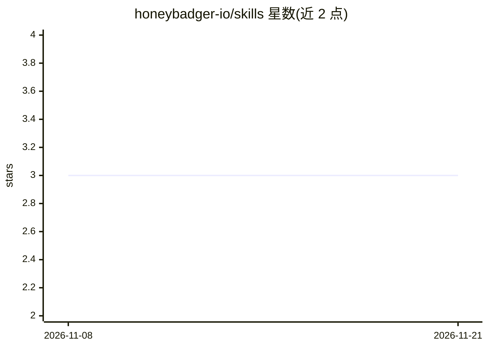

# honeybadger-io/skills

⭐ 3 · JavaScript · MIT · 推送 2026-11-20 · [GitHub](https://github.com/honeybadger-io/skills) · [官网](https://www.honeybadger.io/) · 组织维护

**教 AI 编码代理使用 Honeybadger 错误追踪的技能与 MCP 服务器**

由 Honeybadger 官方提供的技能包与 MCP 服务器集合，供 AI 编码代理接入 Honeybadger：在对话中完成应用接入、查找生产错误、读取堆栈、定位根因并修复，另支持定时任务 check-in、Insights 告警创建与解释、事件调查和仪表盘构建。提供 npx 向导自动为检测到的代理安装，并为 Claude Code、Codex、Copilot CLI、Pi 提供各自插件命令，Cursor/OpenCode 等通过复制技能目录与 MCP 配置接入。需 Honeybadger 账户，区分 US/EU 区域服务器。

## 筛选速览

| 维度 | 判定 | 备注 |
|---|---|---|
| AI 角色 | `ai-ecosystem` | LLM/agent 周边工具 |
| 许可风险 | `permissive` | MIT |
| 部署形态 | `library` | 以包/库形式分发 |
| 模型依赖 | — | README 未给出锁定关系 |
| 硬件要求 | — | 无带数字的原话,不猜 |
| 安装摩擦 | `low` | 无编译、无系统依赖或容器化 |
| 成熟度 | — | 结构信号不足 |

## 能力要点

- 6 个技能：接入、错误调试、任务监控、告警、事件调查、仪表盘
- npx 向导自动为检测到的编码代理安装技能与 MCP 服务器
- 支持 US/EU 两套 MCP 区域服务器
- 兼容 Agent Plugins / Agent Skills 标准的任意代理

## 适用场景

- 让 Claude Code 或 Cursor 直接读取并修复生产错误
- 在对话中为定时任务添加 check-in 监控
- 用自然语言创建和调整 Insights 告警与仪表盘

## 场景标签

`编码 Agent` · 领域:编码与开发

## 证据(README 行号)

> L3: Skills and an MCP server that teach AI coding agents how to use Honeybadger: find production errors, read the backtr
> L5: Works with Claude Code, Codex, GitHub Copilot CLI, Cursor, and any agent that supports the Agent Plugins standard or

## 星数曲线

2026-11-08 3 → 2026-11-21 3（+0）

---
*卡片 v1 · prompt 1.4 · 生成 2026-11-21 · 置信度 high · 依据 README sha `a05804c7ad0c` · [字段定义](../../DATASET.md)*
