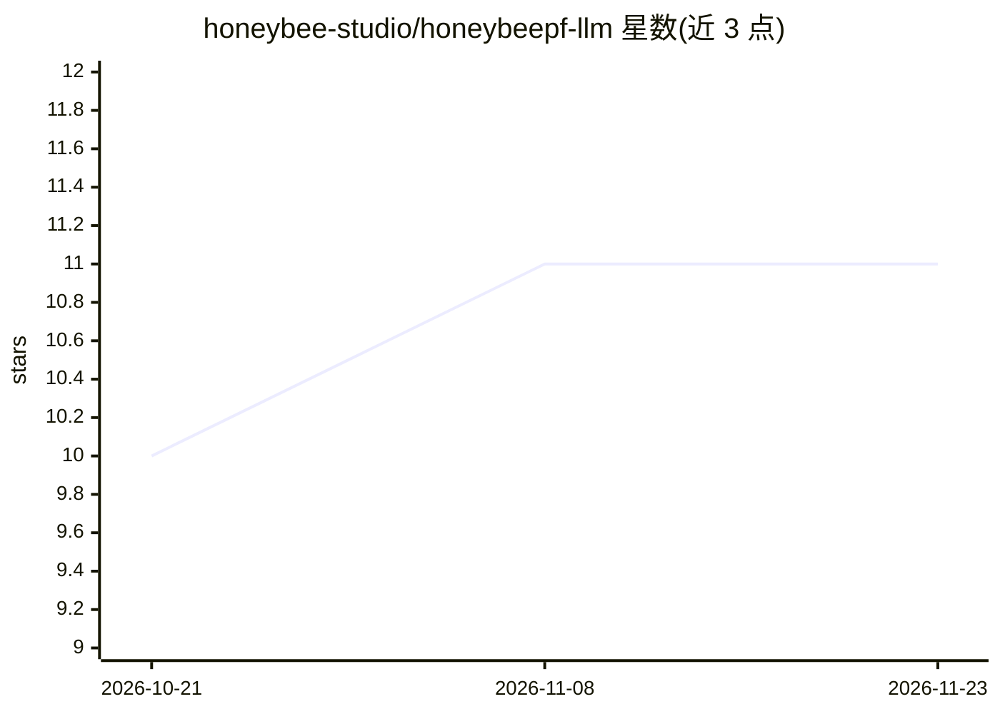

# honeybee-studio/honeybeepf-llm

⭐ 11 · Rust · Apache-2.0 · 推送 2026-11-22 · [GitHub](https://github.com/honeybee-studio/honeybeepf-llm) · 组织维护

**K8s 集群的 eBPF LLM 观测代理：无侵入统计用量与成本**

以 Rust 编写、以 DaemonSet 运行的 eBPF 代理：向 OpenSSL SSL_write/SSL_read 与 Go crypto/tls 挂载 uprobes，读取节点上各进程调用 LLM 的明文 HTTP，解析出 token 用量、请求次数与延迟，按 namespace/pod 通过 OpenTelemetry 导出，并按内置价格表估算美元成本。无需修改应用代码、无代理、无 SDK。要求 Linux 5.10+ 或 RHEL 8.10/9.6/9.7 内核；通过 Helm chart 安装；API key 不会被记录。

## 筛选速览

| 维度 | 判定 | 备注 |
|---|---|---|
| AI 角色 | `ai-ecosystem` | LLM/agent 周边工具 |
| 许可风险 | `permissive` | Apache-2.0 |
| 部署形态 | `library` | 以包/库形式分发 |
| 模型依赖 | local-ok | 支持本地模型 |
| 硬件要求 | — | 无带数字的原话,不猜 |
| 安装摩擦 | `low` | 无编译、无系统依赖或容器化 |
| 成熟度 | — | 结构信号不足 |

## 能力要点

- uprobes 挂载 TLS 函数，无需改代码/代理/SDK 即可采集 LLM 调用
- 按 namespace/pod/model 统计 token 与估算美元成本，导出 OpenTelemetry 指标
- 内置主流 provider 识别与价格表，未定价模型计为 unpriced tokens
- 附带 mock provider 演示环境，无需 API key

## 适用场景

- 按团队拆分 Kubernetes 集群内的 LLM 账单
- 监控各工作负载的 token 用量与调用延迟
- 审计节点上敏感的模型调用而无需接入 SDK

## 场景标签

`LLM 可观测性` · 领域:评测与运维

## 证据(README 行号)

> L27: honeybeepf-llm is a Rust eBPF agent that runs as a DaemonSet. It attaches uprobes to OpenSSL's `SSL_write` and
> L29: request counts, latency and estimated cost per Kubernetes namespace and pod over OpenTelemetry.

## 星数曲线

2026-10-21 10 → 2026-11-23 11（+1）

---
*卡片 v1 · prompt 1.4 · 生成 2026-11-18 · 置信度 high · 依据 README sha `05bbff528eba` · [字段定义](../../DATASET.md)*
