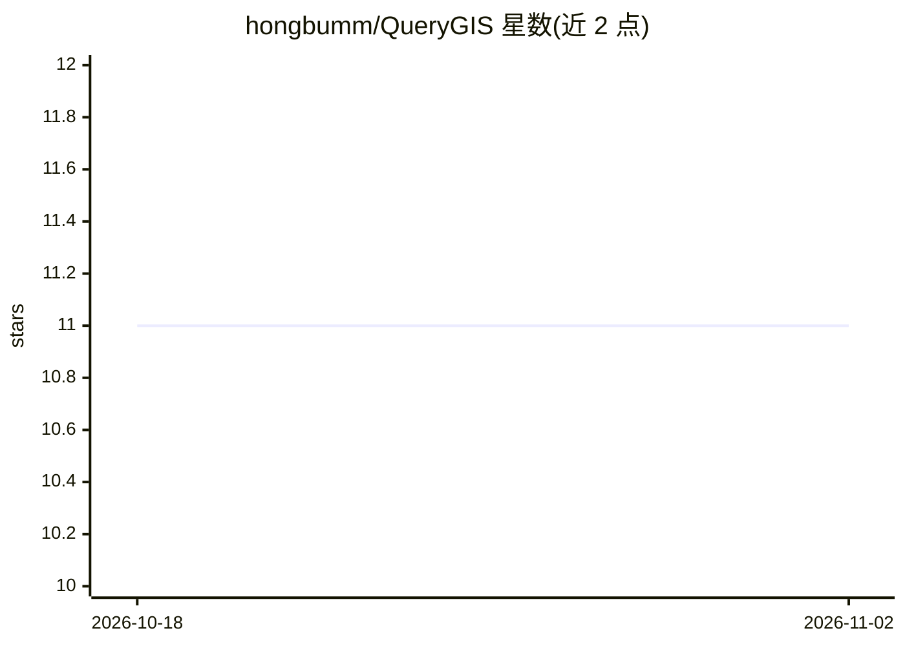

# hongbumm/QueryGIS

⭐ 11 · Python · 推送 2026-03-10 · [GitHub](https://github.com/hongbumm/QueryGIS) · 组织维护

**QGIS 的 LLM 聊天插件：自然语言生成可执行 GIS 工作流**

面向 GIS 分析师、研究者、遥感从业者和机构的 QGIS 插件：用户以自然语言描述任务，QueryGIS 生成可执行的 GIS 步骤（缓冲区、叠加、栅格预处理、可视化等），替代菜单导航与重复脚本试错。安装方式为 QGIS 插件管理器导入 .zip 包。目标正式发布时间为 2026 年第二季度，当前提供早期 Beta 参与渠道，并附 YouTube 演示视频。项目方同时提供机构/大学的 GIS+AI 培训与咨询。曾进入 2025 AI Champion 大赛 Top 20 并获 TTA Award。

## 筛选速览

| 维度 | 判定 | 备注 |
|---|---|---|
| AI 角色 | `ai-native` | 本体是模型或模型工具 |
| 许可风险 | `none` | — |
| 部署形态 | `None` |  |
| 模型依赖 | — | README 未给出锁定关系 |
| 硬件要求 | — | 无带数字的原话,不猜 |
| 安装摩擦 | `low` | 无编译、无系统依赖或容器化 |
| 成熟度 | `idea` | |

## 能力要点

- 自然语言交互生成可执行 GIS 分析/可视化/数据处理步骤
- 覆盖空间分析（缓冲/叠加）、栅格与遥感预处理、图层样式
- 以 QGIS 插件 .zip 包形式安装，通过工具栏面板运行

## 适用场景

- 用对话方式让 QGIS 执行空间分析而不用反复写脚本
- 降低 GIS 工作流的学习门槛，快速从想法到执行
- 机构内做 AI 辅助的地理空间日常作业

## 场景标签

`数据分析` · 领域:效率与自动化

## 证据(README 行号)

> L7: QueryGIS는 QGIS를 위한 AI 인터페이스로, GIS 분석가, 연구자, 원격탐사 실무자, 기관/조직이 의도(intent)에서 실행(execution)까지 더 자연스럽고 효율적으로 이동하도록 돕습니다.
> L11: QueryGIS는 사용자가 QGIS와 자연어로 상호작용하고, 실행 가능한 GIS 단계를 생성하며, 반복적인 시행착오 스크립팅 없이 공간 분석을 가속화하도록 지원합니다.
> L24: - **실행 가능한 GIS 가이드**

## 星数曲线

2026-10-18 11 → 2026-11-02 11（+0）

---
*卡片 v1 · prompt 1.4 · 生成 2026-11-02 · 置信度 high · 依据 README sha `679e09b03e02` · [字段定义](../../DATASET.md)*
