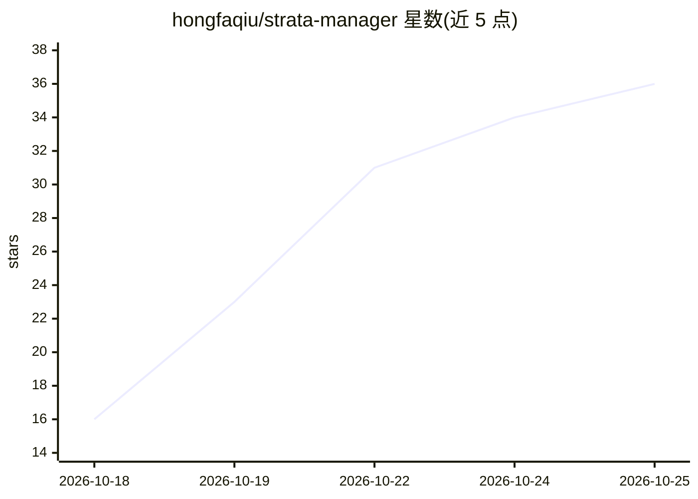

# hongfaqiu/strata-manager

⭐ 36 · Rust · MIT · 推送 2026-10-25 · [GitHub](https://github.com/hongfaqiu/strata-manager) · [官网](https://strata-manager.cosfoc.com) · 个人维护 · 中文 README

**本地 LLM 引擎 Strata 的桌面管理工作区：安装、模型管理与监控**

面向本地 LLM 推理引擎 Niko1221/Strata 的开源桌面管理应用（Tauri 2，Windows/Linux x64，macOS Apple Silicon 为实验性）。提供引导式首次安装（含引擎包一键安装、失败自动回滚、缺失 Python 一键补装）、模型下载与配置管理、服务控制、聊天界面、API/MCP 连接在线验证、用量统计、监控、调优与基准测试（可选匿名公开排行榜）。管理本机已安装的 Strata 运行时，模型权重独立安装；另支持 Linux 实验性 headless 服务端。

## 筛选速览

| 维度 | 判定 | 备注 |
|---|---|---|
| AI 角色 | `ai-ecosystem` | LLM/agent 周边工具 |
| 许可风险 | `permissive` | MIT |
| 部署形态 | `desktop` | 安装包/桌面程序 |
| 模型依赖 | — | README 未给出锁定关系 |
| 硬件要求 | — | 无带数字的原话,不猜 |
| 安装摩擦 | `medium` | 含编译或系统依赖之一 |
| 成熟度 | `idea` | |

## 能力要点

- Strata 0.2.0 引擎签名包一键安装与失败自动回滚
- 模型目录含 GGUF 元数据、显存适配提示与已有 GGUF 复用（--gguf-dir）
- API 连接逐步在线验证与 MCP 配置
- 基准测试七场景/并发阶梯，结果可匿名分享至公开排行榜

## 适用场景

- 在本机一站式安装并管理 Strata 推理引擎与本地模型
- 监控本地 API 用量、硬件负载与生成速度
- 对本机模型做调优与基准测试并对比配置版本
- 在 Linux 服务器上以 headless 模式浏览器访问同一界面

## 场景标签

`推理引擎` `模型评测` · 领域:评测与运维

## 证据(README 行号)

> L19: **Strata Manager is an open-source desktop management app for Niko1221/Strata, a local large language model inferen
> L34: |**Strata Manager**|Prepare and inspect the runtime, manage local models and configurations across Strata versions,
> L29: Strata is an open-source local LLM inference engine. It coordinates GPU memory, RAM and CPU resources to run suppor

## 星数曲线

2026-10-18 16 → 2026-10-25 36（+20）

---
*卡片 v1 · prompt 1.4 · 生成 2026-10-25 · 置信度 mid · 依据 README sha `0cf6e95dfbe2` · [字段定义](../../DATASET.md)*
