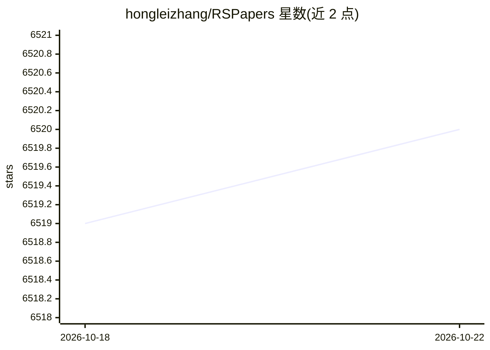

# hongleizhang/RSPapers

⭐ 6,520 · MIT · 推送 2026-03-12 · [GitHub](https://github.com/hongleizhang/RSPapers) · 个人维护 · 中文 README

**推荐系统必读论文与教程策展清单，18 个主题分类**

由个人维护的推荐系统（RS）论文精选清单，收录教程、综述与研究论文，按 18 个主题组织：Tutorials、Surveys、General RS、Social RS、Deep Learning-based RS、Cold Start、POI RS、Efficient RS、EE Problem、Explainability、CTR Prediction、Knowledge Graph for RS、Review based RS、Conversational RS、Industrial RS、Privacy&Security RS、LLM for RS、Agentic RS。条目为『作者、论文标题、会议/期刊、年份』格式，部分附 pdf 链接；通过 pull request 按模板贡献。

## 筛选速览

| 维度 | 判定 | 备注 |
|---|---|---|
| AI 角色 | `ai-knowledge` | 知识聚合/清单类 |
| 许可风险 | `permissive` | MIT |
| 部署形态 | `None` |  |
| 模型依赖 | — | README 未给出锁定关系 |
| 硬件要求 | — | 无带数字的原话,不猜 |
| 安装摩擦 | `low` | 无编译、无系统依赖或容器化 |
| 成熟度 | — | 结构信号不足 |

## 能力要点

- 覆盖 18 个推荐系统研究主题的论文分类组织
- 收录从 1992 年 GroupLens 到 2024 年 LLM for RS 的论文脉络
- 包含各顶会教程（RecSys/SIGIR/WWW/CIKM/IJCAI 等）
- 以固定 markdown 模板通过 pull request 接受贡献

## 适用场景

- 系统性地阅读推荐系统领域必读论文
- 按子方向（如冷启动、可解释性、知识图谱）查找文献
- 跟踪 LLM 与 agent 在推荐系统中的研究进展

## 场景标签

`精选清单` `推荐系统` `科研工具` · 领域:学习与行业

## 证据(README 行号)

> L1: # Must-read papers on Recommender System
> L5: This repository provides a curated list of papers and tutorials about Recommender Systems (RS) including systematic 
> L15: **00-Tutorials:** contain so many tutorials on recommendation systems given by prominent researchers at many top-ti

## 星数曲线

2026-10-18 6,519 → 2026-10-22 6,520（+1）

---
*卡片 v1 · prompt 1.4 · 生成 2026-10-20 · 置信度 high · 依据 README sha `34e709570f5f` · [字段定义](../../DATASET.md)*
