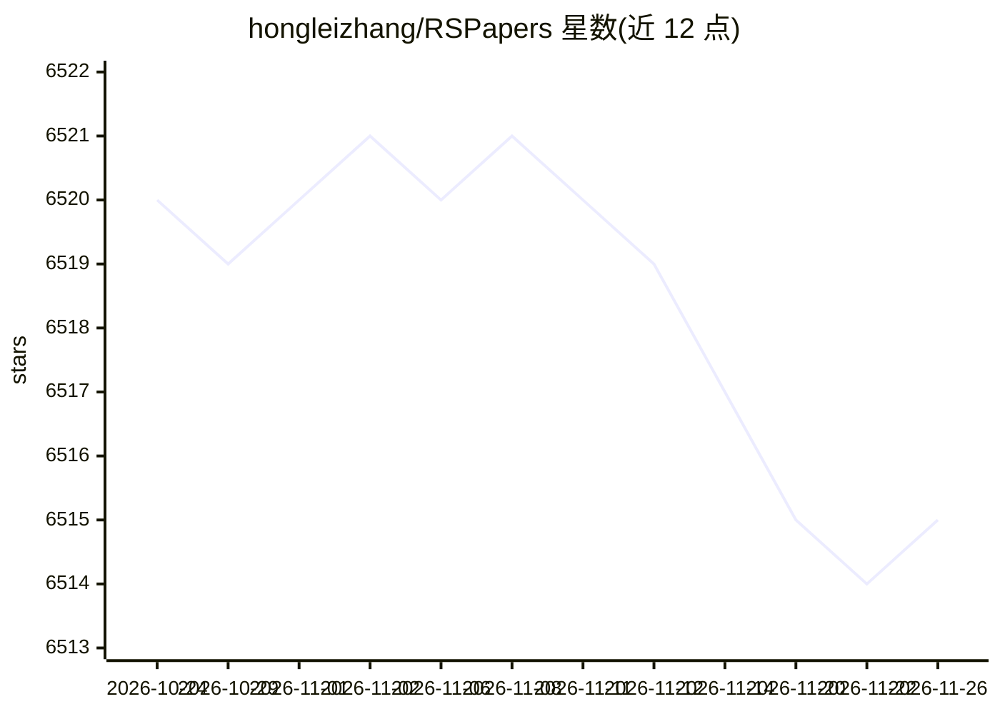

# hongleizhang/RSPapers

⭐ 6,515 · MIT · 推送 2026-10-26 · [GitHub](https://github.com/hongleizhang/RSPapers) · 个人维护

**推荐系统必读论文与教程的策展清单**

按 17 个主题组织推荐系统论文与教程：包括顶会教程汇总、综述，以及通用/社交/深度学习/冷启动/效率/可解释性/CTR 预测/知识图谱/对话式/工业界/隐私安全/LLM/Agentic RS 等分类条目，每条按「作者、论文名、会议/期刊、年份」格式收录。面向从事推荐系统研究与学习的读者，通过 pull request 按模板贡献补充条目。

## 筛选速览

| 维度 | 判定 | 备注 |
|---|---|---|
| AI 角色 | `ai-knowledge` | 知识聚合/清单类 |
| 许可风险 | `permissive` | MIT |
| 部署形态 | `None` |  |
| 模型依赖 | — | README 未给出锁定关系 |
| 硬件要求 | — | 无带数字的原话,不猜 |
| 安装摩擦 | `low` | 无编译、无系统依赖或容器化 |
| 成熟度 | — | 结构信号不足 |

## 能力要点

- 17 个主题分类组织论文与教程
- 含顶会教程汇总与综述专类
- 新增 LLM for RS 与 Agentic RS 章节
- 模板化 PR 机制接受社区补充

## 适用场景

- 系统学习推荐系统领域的经典与前沿论文
- 为综述写作收集某一子方向文献
- 了解 LLM 与 Agent 在推荐系统中的研究进展

## 场景标签

`推荐系统` `教程课程` `精选清单` · 领域:学习与行业

## 证据(README 行号)

> L1: # Must-read papers on Recommender System
> L5: This repository provides a curated list of papers and tutorials about Recommender Systems (RS) including systematic 
> L48: **16-LLM for RS:** some papers about large language models in recommder systems.

## 星数曲线

2026-10-24 6,520 → 2026-11-26 6,515（-5）

---
*卡片 v1 · prompt 1.4 · 生成 2026-11-22 · 置信度 high · 依据 README sha `5fd5304821de` · [字段定义](../../DATASET.md)*
