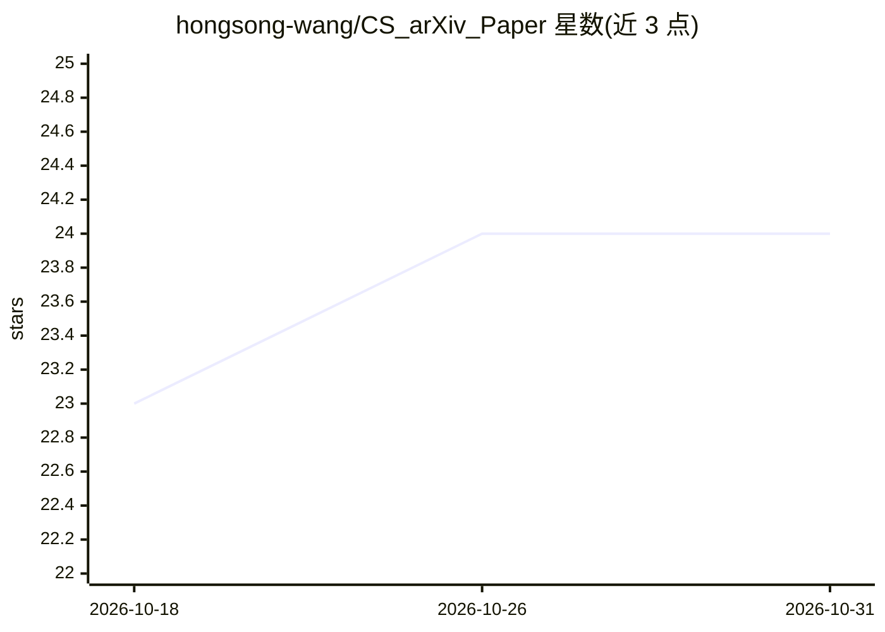

# hongsong-wang/CS_arXiv_Paper

⭐ 24 · 推送 2026-09-07 · [GitHub](https://github.com/hongsong-wang/CS_arXiv_Paper) · [官网](https://hongsong-wang.github.io/CS_arXiv_Paper/) · 个人维护 · 中文 README

**计算机科学 arXiv 论文摘要导航页（2025-2026）**

个人维护的 arXiv 计算机科学论文聚合网页：按月份（2025 年 1 月至 2026 年 6 月）与领域（人工智能、机器学习、计算机视觉、计算语言学、密码学与安全、机器人、系统与控制、人机交互）组织论文摘要链接，收录公开代码的论文及由算法自动筛选的未公开代码论文，供学生与研究者按关键词快速定位文献。通过 GitHub Pages 以网页形式提供，转载需注明出处且不得改动原文。

## 筛选速览

| 维度 | 判定 | 备注 |
|---|---|---|
| AI 角色 | `ai-knowledge` | 知识聚合/清单类 |
| 许可风险 | `none` | — |
| 部署形态 | `None` |  |
| 模型依赖 | — | README 未给出锁定关系 |
| 硬件要求 | — | 无带数字的原话,不猜 |
| 安装摩擦 | `low` | 无编译、无系统依赖或容器化 |
| 成熟度 | — | 结构信号不足 |

## 能力要点

- 覆盖 2025-2026 年 8 个计算机科学领域的 arXiv 论文摘要
- 按月份与领域分类组织条目
- 部分未公开代码的论文由算法自动筛选收录

## 适用场景

- 按领域和月份浏览近期 arXiv 计算机科学论文
- 快速定位附带公开代码的论文
- 配合同作者的 CV_Paper_Portal、AI_arXiv_Portal 做文献调研

## 场景标签

`精选清单` · 领域:学习与行业

## 证据(README 行号)

> L3: To help students and researchers quickly locate relevant papers based on keywords, I compiled abstracts from arXiv i
> L10: |Artificial Intelligence|Machine Learning|Computer Vision|Computation and Language|

## 星数曲线

2026-10-18 23 → 2026-10-31 24（+1）

---
*卡片 v1 · prompt 1.4 · 生成 2026-10-27 · 置信度 high · 依据 README sha `af760e55e79c` · [字段定义](../../DATASET.md)*
