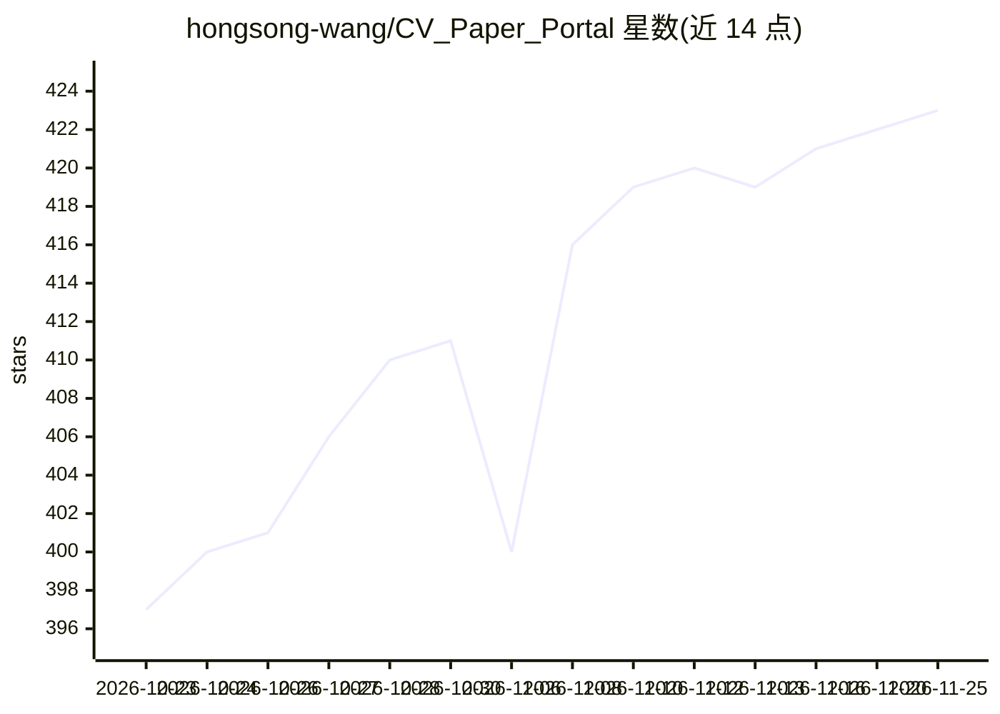

# hongsong-wang/CV_Paper_Portal

⭐ 423 · 推送 2026-10-27 · [GitHub](https://github.com/hongsong-wang/CV_Paper_Portal) · [官网](https://hongsong-wang.github.io/CV_Paper_Portal/) · 个人维护 · 中文 README

**CV/AI/ML/NLP/机器人顶会论文网页目录：按关键词快速定位论文**

将计算机视觉、自然语言处理、机器学习、机器人等领域的顶级会议（CVPR、ICCV、ECCV、ACL、NeurIPS、ICML、CoRL 等）历年论文摘要整合为网页，数据主要采集自 arXiv，按会议与年份组织链接，便于学生和研究者按关键词检索论文。另维护 AI_Journal_Portal、AI_arXiv_Portal、CS_arXiv_Paper 等姊妹门户。内容为静态网页集合，README 未提供安装或运行方式，转载需注明出处。

## 筛选速览

| 维度 | 判定 | 备注 |
|---|---|---|
| AI 角色 | `ai-knowledge` | 知识聚合/清单类 |
| 许可风险 | `none` | — |
| 部署形态 | `None` |  |
| 模型依赖 | — | README 未给出锁定关系 |
| 硬件要求 | — | 无带数字的原话,不猜 |
| 安装摩擦 | `low` | 无编译、无系统依赖或容器化 |
| 成熟度 | — | 结构信号不足 |

## 能力要点

- 覆盖视觉、语言、学习、机器人四大领域的 15+ 顶会历年论文页
- 摘要数据主要采集自 arXiv
- 按会议与年份（部分可回溯至 2009 年及更早）组织链接
- 另维护 AI 期刊与 arXiv 论文检索门户等姊妹仓库

## 适用场景

- 按关键词查找 CVPR/NeurIPS 等顶会历年论文
- 调研某会议某年份的论文集合
- 快速定位论文摘要与原文链接

## 场景标签

`科研工具` · 领域:学习与行业

## 证据(README 行号)

> L15: To facilitate students and researchers in quickly locating papers based on keywords, I consolidated the abstracts f
> L21: # Conference on Computer Vision and Pattern Recognition (CVPR)
> L59: 2026, &nbsp; 2025, &nbsp; 2024, &nbsp; 2023, &nbsp; 2022, &nbsp; 2021, &nbsp; 2020, &nbsp; 2019, &nbsp; 2018, &nbsp

## 星数曲线

2026-10-23 397 → 2026-11-25 423（+26）

---
*卡片 v1 · prompt 1.4 · 生成 2026-11-25 · 置信度 high · 依据 README sha `4dc7d3fdd52e` · [字段定义](../../DATASET.md)*
