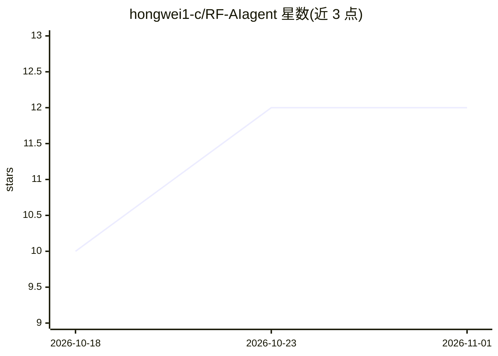

# hongwei1-c/RF-AIagent

⭐ 12 · Python · 推送 2026-08-31 · [GitHub](https://github.com/hongwei1-c/RF-AIagent) · 个人维护 · 中文 README

**AI-Agent 驱动的射频设计系统，自动完成 HFSS 仿真闭环**

面向射频工程师的自动化设计系统：用户输入需求后，AI-Agent（LLM 与物理规则混合决策）自主完成需求理解、参数设定、HFSS 建模仿真、结果导出与合格判定，支持微带贴片/缝隙/PIFA 天线、带通/低通/高通滤波器、Wilkinson/T 型功分器及微带/差分/耦合传输线等器件。通过 COM 接口控制 HFSS，支持 2.45GHz+5GHz 双频设计与批量工作流，自动分类合格/不合格设计并生成报告。需本地 HFSS 环境，通过 git clone 获取源码运行。

## 筛选速览

| 维度 | 判定 | 备注 |
|---|---|---|
| AI 角色 | `ai-native` | 本体是模型或模型工具 |
| 许可风险 | `none` | — |
| 部署形态 | `None` |  |
| 模型依赖 | — | README 未给出锁定关系 |
| 硬件要求 | — | 无带数字的原话,不猜 |
| 安装摩擦 | `low` | 无编译、无系统依赖或容器化 |
| 成熟度 | — | 结构信号不足 |

## 能力要点

- LLM + 物理规则混合决策的闭环自动调参
- COM 接口控制 HFSS，自动仿真并导出结果
- 覆盖天线/滤波器/功分器/传输线多类器件
- 批量工作流自动分类合格与不合格设计并生成报告

## 适用场景

- 不会 HFSS 操作的工程师用一句话完成天线仿真设计
- 双频（2.45GHz/5GHz）天线参数自动优化
- 批量跑设计并自动筛选合格结果出报告

## 场景标签

`工作流自动化` · 领域:效率与自动化

## 证据(README 行号)

> L7: > 🚀 **AI-Agent 驱动的射频设计系统 | HFSS 自动化仿真 | 智能优化**
> L24: |🤖 **AI-Agent闭环优化** *(AI-Agent Closed-loop Optimization)*|LLM + 物理规则混合决策，自动调参 *LLM + physics-based hybrid decision-

## 星数曲线

2026-10-18 10 → 2026-11-01 12（+2）

---
*卡片 v1 · prompt 1.4 · 生成 2026-11-01 · 置信度 high · 依据 README sha `8d9c0aef531e` · [字段定义](../../DATASET.md)*
