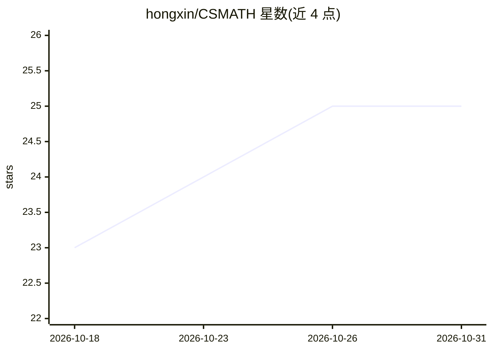

# hongxin/CSMATH

⭐ 25 · 推送 2026-03-17 · [GitHub](https://github.com/hongxin/CSMATH) · 组织维护 · 中文 README

**面向计算机博士新生的数学课程仓库（统计学习/优化/偏微分方程/泛函）**

浙江大学计算机学院开设的博士生一年级数学课程 CS-MATH（2005-2026 持续更新）的课程资料仓库。内容分四个单元：多元统计方法初步（SVD、PCA、聚类、图模型等）、非线性优化求解技术、偏微分方程（level-set、椭圆与 Poisson 方程）以及应用泛函分析。以课表、讲义幻灯片和 Python 作业形式组织，要求学生提交 5 次作业与 1 篇课程论文，作业均需用 Python 实现。

## 筛选速览

| 维度 | 判定 | 备注 |
|---|---|---|
| AI 角色 | `ai-knowledge` | 知识聚合/清单类 |
| 许可风险 | `none` | — |
| 部署形态 | `None` |  |
| 模型依赖 | — | README 未给出锁定关系 |
| 硬件要求 | — | 无带数字的原话,不猜 |
| 安装摩擦 | `low` | 无编译、无系统依赖或容器化 |
| 成熟度 | — | 结构信号不足 |

## 能力要点

- 课程覆盖统计学习、非线性优化、偏微分方程、应用泛函分析四个单元
- 提供课程幻灯片与按周次排布的课表（2026 春季学期）
- 作业与课程论文要求以 Python 实现
- 列出 PRML、Pattern Classification、ESL 三本教材及斯坦福机器学习课程参考

## 适用场景

- 博士生新生系统学习计算机研究常用数学方法
- 查找统计学习与优化方向的课程讲义和作业
- 参考浙大课程组织形式设计同类研究生数学课

## 场景标签

`教程课程` · 领域:学习与行业

## 证据(README 行号)

> L4: This mathematics course is designed for the first year Ph.D. students of computer science and related areas. The cou
> L7: 本课程是为计算机及相关专业的博士生新生开设的一门数学课程。本课程教授在计算机科学和信息处理研究领域相关的数学方法论、技术、概念以及基本算法。试图以数学的直观引导，清晰的概念解释，生动的应用实例，为学生开始进入这些领域的研究提供一个数
> L20: + Room 202, Building 2, Yuquan Campus, Zhejiang University

## 星数曲线

2026-10-18 23 → 2026-10-31 25（+2）

---
*卡片 v1 · prompt 1.4 · 生成 2026-10-27 · 置信度 high · 依据 README sha `5a1598f223d3` · [字段定义](../../DATASET.md)*
