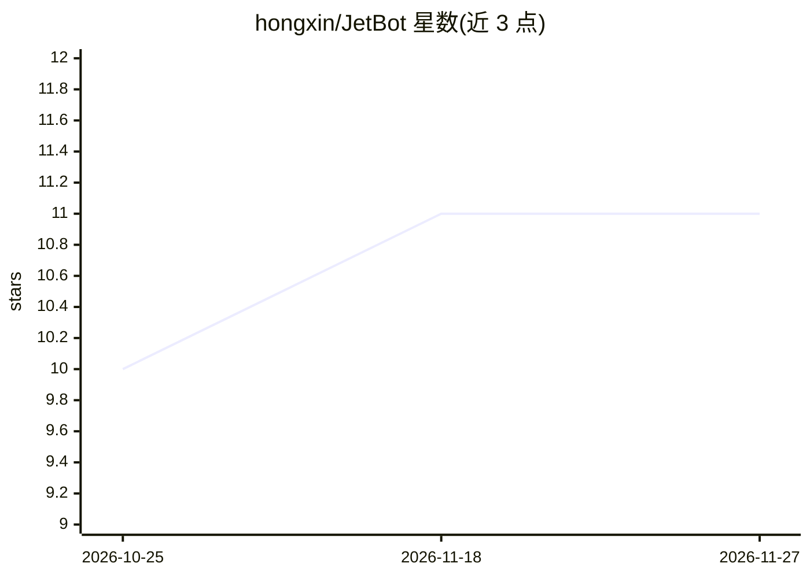

# hongxin/JetBot

⭐ 11 · TypeScript · 推送 2026-10-17 · [GitHub](https://github.com/hongxin/JetBot) · [官网](https://hongxin.github.io/JetBot/) · 个人维护 · 中文 README

**纯浏览器端 AI 编程助手：打开页面即用，无需后端**

JetBot 是一个完全在浏览器内运行的 AI 编程助手，无后端服务器、无部署流程、无需安装；LLM 调用由浏览器 fetch() 直连 API 提供商。核心机制包括最多 100 次迭代的自主工具调用循环（带熔断与重复错误检测）、10 个内置工具、18 个可注入系统提示词的技能、三级权限审批体系。会话、记忆与调度任务持久化于 IndexedDB；对话以力导向图（Cosmos）呈现，支持记忆与技能节点及中英双语界面。

## 筛选速览

| 维度 | 判定 | 备注 |
|---|---|---|
| AI 角色 | `ai-native` | 本体是模型或模型工具 |
| 许可风险 | `none` | — |
| 部署形态 | `library` | 以包/库形式分发 |
| 模型依赖 | local-ok | 支持本地模型 |
| 硬件要求 | — | 无带数字的原话,不猜 |
| 安装摩擦 | `low` | 无编译、无系统依赖或容器化 |
| 成熟度 | — | 结构信号不足 |

## 能力要点

- 10 个内置工具的自主 agentic 循环，带熔断保护与重复错误检测
- 18 个内置技能，通过 /skill 命令注入系统提示词
- 三级权限系统（safe/risky/dangerous）与自治模式开关
- 会话、记忆、技能持久化于 IndexedDB，支持崩溃恢复与跨会话召回

## 适用场景

- 打开浏览器直接让 AI 编写并预览小游戏或页面
- 接入自己的 API key 或本地 Ollama 做离线编程辅助
- 用技能与记忆系统积累可复用的编程经验

## 场景标签

`编码 Agent` · 领域:编码与开发

## 证据(README 行号)

> L7: JetBot is a fully browser-based AI coding assistant. No backend server, no deployment pipeline, no installation requ
> L53: An autonomous tool-calling loop where the LLM selects tools, executes actions, and analyzes results until the task 

## 星数曲线

2026-10-25 10 → 2026-11-27 11（+1）

---
*卡片 v1 · prompt 1.4 · 生成 2026-11-18 · 置信度 high · 依据 README sha `cf1226b5d4f4` · [字段定义](../../DATASET.md)*
